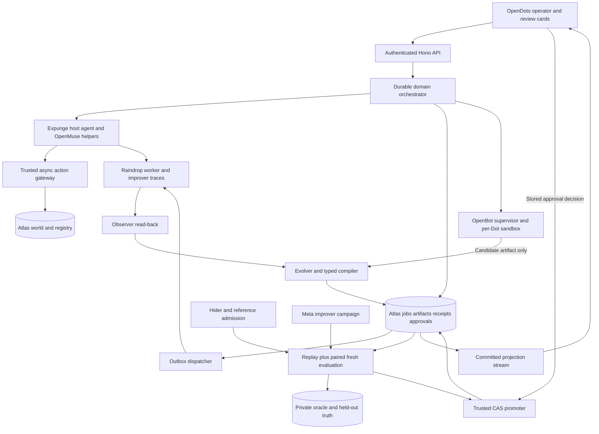

# Expunge Implementation Blueprint

**Build:** a database cleanup agent whose context, workflow, guardrails and tools evolve from measured failures. Use OpenDots as the operator workspace, its pinned OpenBot computer services for isolated execution, actual OpenMuse runtime helper code in the worker, MongoDB as the task and improvement authority, and Raindrop as the observed evidence path.

**Scope:** full product, governance, privacy lineage, adversarial curriculum and an independently measured improver experiment. One human coordinates parallel Codex agents. This is a build-ready plan, not implemented application code. Existing research is retained; this document is the authoritative implementation recommendation.

**Primary problem statement:** Statement One, Recursive Harnessing. The evidence is a generated executable environment change, independently admitted and then used by a new run with the same model. Durable checkpoints and memory remain full-scope features; they do not establish Statement Two's billion-token or comparable single-session duration claim. The [resource guide evaluation](docs/expunge/RESOURCE-GUIDE-EVALUATION.md) records the directly read guide and its limits.

## 1 Deliverables and reading order

| Document | Purpose |
|---|---|
| [Contracts](docs/expunge/CONTRACTS.md) | IDs, typed harness, jobs, effects, receipts, evidence, approval, promotion and evaluation semantics. Freeze before parallel edits. |
| [MongoDB data model](docs/expunge/DATA-MODEL.md) | Databases, collections, indexes, principals, validation, fencing, transaction/recovery and privacy protocols. |
| [Parallel Codex task packets](docs/expunge/AGENT-TASKS.md) | Fifteen owned tasks, dependency waves, documentation references, verification and anti-pattern guards. |
| [Acceptance and demo](docs/expunge/ACCEPTANCE.md) | Full-scope feature matrix, race/failure checks, scientific protocol and stage path. |
| [Allowed APIs and sources](docs/expunge/SOURCE-MAP.md) | Pinned source, actual vendor methods, copy-ready reference locations and Firecrawl evidence. |
| [Foundation facts](docs/research/blueprint-foundations.md) | Exact OpenDots/OpenBot/OpenMuse/AG-UI seams and version constraints. |
| [MongoDB facts](docs/research/blueprint-mongodb.md) | Exact driver/server facts, fencing/approval sketches and deployment limits. |
| [Raindrop facts](docs/research/blueprint-raindrop.md) | Actual SDK declarations, Query OpenAPI, asynchronous evidence and privacy lifecycle. |

The proposed application contract names in these documents are new code to implement. Vendor APIs are identified separately. Every implementation phase must read its specific source examples and produce actual verification evidence.

## 2 Product behavior and full scope

An operator requests cleanup of a synthetic subject within a registered company data scope. The agent resolves the subject, discovers linked records, previews eligible effects, executes bounded batches, verifies observed scope and reports a database-backed receipt. The independent evaluator may expose a copy the agent missed. Raindrop retains the actual tool/model trace and failure evidence. The improver proposes an executable harness change; a fixed gate tests it on reset paired worlds and protected cases. A passing version is promoted in Atlas. New runs use that version with the same model.

The complete build includes:

1. Multiple specialist roles: operator, worker, observer, evolver, verifier, promoter, Hider and meta-improver, with explicit durable job dispatch.
2. Four editable worker surfaces: context selection, workflow graph, guardrail AST and tool grants/prerequisites.
3. Typed composition plus isolated candidate source plugins where claimed; no privileged evaluator/backend source is model-editable.
4. Historical as-of decision replay and fresh behavioral reruns.
5. Stored human approval for authority expansion, atomic promotion, rollback and pinned runs.
6. Structural failure recall, version lineage and provenance-aware context eligibility.
7. Source/trace erasure lifecycle that preserves only permitted structural learning.
8. Adversarial data-layout generation under reference-solver admission.
9. An evolved improver tested by the fresh workers it produces.
10. Real deployment, recovery, evidence export and a three-minute demonstration.

The demonstration uses synthetic subjects and controlled world writers. A receipt states its registered coverage/revision; a hidden test establishes correctness in that fixture. Owner-defined retention/eligibility rules remain outside the learner. Delete, redact, restrict and tombstone are product effects, not a claim of automatic legal compliance.

## 3 Architecture and service topology



**Operator process:** OpenDots-derived React/Vite and Hono app, preserved owner/session/origin controls, CopilotKit Intelligence conversations and incidental SQLite state. Its registered ExpungeProjectionAgent submits/observes durable jobs and emits finite turn acknowledgments/review cards; it does not execute the long-running model campaign. The separate authenticated events route supplies continuing committed job projection. A finished UI turn is not a finished domain job. Its native 90-second turn runner is not used to run an entire cleanup/evolution campaign.

**Domain worker process:** long-lived bounded worker pool with Atlas job leases/checkpoints. Its ExpungeExecutionAgent runs fixed-model worker/improver roles through the imported OpenMuse helper path, with inner agent construction inside its run. It can pause for evidence or approval without keeping a model invocation open. Role-specific capabilities come from the trusted dispatcher. B2 owns apps/worker entrypoints/dispatch; the operator may enqueue/wake a job through the authenticated domain client but never supplies its authoritative actor or pin.

**Gateway/authority services:** a scoped executor, independent grader and promoter use separate minimum MongoDB principals. The model receives typed tools, not connection strings. Each service checks its own actor/job bindings. The grader's private manifest is absent from the worker and candidate images.

**Computer host:** OpenDots' existing supervisor and per-Dot OpenBot images. Only the supervisor has the Docker socket. Candidate computers may edit permitted candidate artifacts and run local checks, with restricted network/resources and no domain/grader/admin credentials. Restrictive egress is new work: the upstream composition does not provide it. A1 owns the candidate-network/container overlay; B2 owns its artifact/broker access and containment checks. Use an internal candidate network with a default-deny egress/proxy policy, no database/grader/control credentials, bounded filesystem/resources and authenticated control/artifact paths. Confirm that the host implementation really blocks unintended external/internal/metadata targets. They do not promote themselves. The trusted gateway remains the authority for any data effects.

**External services:** Atlas, CopilotKit Intelligence, chosen model provider and Raindrop. A Node-only deployment may host operator/domain APIs, while computer lifecycle needs a Docker-capable host. Use authenticated internal service URLs. No extra broker is required: Atlas jobs/outbox/event logs are the durable coordination layer.

## 4 What is reused and what is new

| Component | Existing source to use | New Expunge implementation |
|---|---|---|
| OpenDots | Authenticated app bootstrap, Platform/runtime agent registration, Chat and HITL cards, ComputerService and supervisor setup. | Domain API, job/candidate/receipt views, new review tool, Atlas projection and explicit specialist dispatch. |
| OpenBot | Bundled computer/supervisor services plus attributed target-resolution/policy/audit algorithm from main gateway. | Async Mongo receipt/history gate, data-action audit and fixed authority floor. Current MCP policy context lacks arbitrary receipt/argument facts. |
| OpenMuse | Copy the actual tanstackAgent provider/state/step-limit helper source and adapt within pinned versions; use ConversationAgent/worker ownership patterns. | Expunge outer agent, job-pinned assembly, trusted state projection, bounded context loader and Atlas-owned lifecycle. |
| MongoDB | Driver/server APIs and Atlas role/index/search features. | Domain world, schemas, typed query compiler, receipts, jobs, artifacts, gates, grants, CAS, provenance and recovery. |
| Raindrop | Interaction/tool/diagnostics/subagent APIs, events/traces Query and account-discovered MCP. | Durable outbox, observer, origin-preserving EvidenceBundle, correlation, causal controls and deletion lifecycle. |

Pin OpenDots `625452e06cde74cb25b0ce319e2c1be0488f5a5f`, OpenMuse `1ac68f3909f2478ab6280883f1ab5ea65eb5719d`, and OpenBot main references `a4dce8c47c7253ecd9bd6f4e2626f4205817a104`. OpenDots' bundled OpenBot services use `b6932d31a8d6e7896c15139dfc27a6c6911deb27`. Keep that distinction in THIRD_PARTY.md.

Start with OpenDots' lock versions: AG-UI 0.0.59, CopilotKit 1.75.0, TanStack AI 0.63.0 and its OpenAI adapter 0.25.1. OpenMuse's helper originated on runtime 1.70.1/TanStack 0.59. State-tool conversion was verified at runtime 1.75; provider compatibility and historical text workarounds still need typecheck and real smoke tests. Do not upgrade every package independently to make one example compile. [Foundation source audit](docs/research/blueprint-foundations.md)

## 5 Repository layout and ownership

Proposed future layout, created by the implementation coordinator:

```text
apps/operator/                    OpenDots-derived app and Expunge UI/routes
apps/worker/                      durable dispatcher and role worker entrypoints
packages/contracts/               schema/types/hashing; coordinator owned
packages/mongo/                   clients repositories indexes transaction helpers
packages/domain/                  registry discovery joins eligibility effects receipts
packages/governance/execute/      trusted async action policy and authority floor
packages/runtime/                 Expunge outer agent provider lifecycle/context
packages/vendor-openmuse/         attributed compatible helper source and patch record
packages/observability/           SDK tracing and telemetry outbox adapters
packages/observer/                Query/MCP read-back evidence and cursor recovery
packages/harness-compiler/        bounded AST and workflow/tool materialization
packages/evolution/               evidence diagnosis proposals and decision replay
packages/gate/                    fixed admission and trial campaigns
packages/deployment/              grants CAS promotion rollback run pinning
packages/fixtures/                admitted world generator and structural split tooling
packages/grader/                  independent private manifest/reference solver
packages/adversary/               Hider campaigns
packages/meta-evolution/          fresh-base improver experiments
packages/privacy/                 source eligibility retraction provider erasure
infra/opendots/                   pinned computer overlays and host topology
infra/deploy/                     service images HTTPS and health configuration
tests/reliability/                crash race containment checks
tests/evaluation/                 frozen benchmark and comparison export
```

The root workspace manager/lockfile is a coordinator decision after booting the imported app unchanged. Preserve one resolved AG-UI version for an in-process runtime. A separate backend may preserve its own compatible dependencies behind the same AG-UI wire protocol, but needs an actual POST/SSE endpoint and authenticated transport. Do not mistake a general OpenBot runtime URL for that endpoint.

## 6 Phase 0 documentation and setup

Read SOURCE-MAP.md and the three source-fact reports. Record allowed signatures in code review. Freeze the initial world/run/candidate/gate/campaign configuration from ACCEPTANCE.md after timing probes, along with semantic compiler/vocabulary/authority hashes. The verified custom host contract is `AbstractAgent` from `@ag-ui/client`, with `run(input): Observable<BaseEvent>`. The inner BuiltInAgent/TanStack factory returns AsyncIterable chunks. An old skill example using an async generator directly from `@ag-ui/core` is incompatible here.

Before building the learning loop, probe:

- The mandatory email-invitation Atlas Hackathon Sandbox: create the project/cluster through the supplied email-linked invitation and prove the deployed runtime uses that sandbox. A personal cluster does not satisfy this check.
- The recommended development sequence: install/provide MongoDB Agent Skills, connect a separate development MCP identity, then use the supplied schema/query guide. Record completion in the kickoff manifest; setup/admin MCP credentials never enter production worker context.
- Atlas sandbox tier/version, custom-role rights, transaction/session behavior, one stream and collection validation.
- OpenDots owner auth/origin and real provider conversation; CopilotKit Intelligence service access.
- Supervisor/per-Dot computer startup and sandbox file/exec path.
- OpenMuse wrapper on the pinned provider/converter/clone path.
- Raindrop real interaction/finish, flush or HTTP acceptance, Query read-back and actual tool schemas when MCP is used.
- Worker/grader/promoter credential separation and hidden manifest denial.

Environment names from upstream: CPK_INTELLIGENCE_API_KEY, CPK_TELEMETRY_ID, OPENAI_API_KEY, OPENAI_MODEL, optional OPENAI_BASE_URL, OWNER_TOKEN, APP_ORIGIN, DATABASE_PATH, COMPUTER_SUPERVISOR_URL, COMPUTER_SUPERVISOR_TOKEN, COMPUTER_TOKEN and COMPUTER_NAMESPACE. Distinct service secrets stay server-side. New Expunge environment examples can define EXPUNGE_EXECUTOR_URI, EXPUNGE_GRADER_URI, EXPUNGE_PROMOTER_URI, EXPUNGE_INTERNAL_TOKEN, RAINDROP_WRITE_KEY, RAINDROP_QUERY_KEY and RAINDROP_PROJECT_ID; these are application choices, not vendor-standard names.

**Verify:** real startup/probe receipts saved; no mocked conversation presented as readiness; source/versions/licenses recorded. **Guards:** no nonexistent native Dot delegation, synchronous Mongo lookup inside an OpenBot policy callback, or unauthenticated model-supplied tenant binding.

## 7 Phase 1 data truth and executable baseline

Create the controlled company world: customers, accounts, messages, events, notes and archives. Cover direct IDs, nested fields, arrays, aliases, reference chains, cycles and unrelated namesakes. Owner policy selects delete/redact/restrict/tombstone eligibility. The trusted generator independently creates private expected poststates and preservation hashes; reference-solver admission quarantines impossible worlds.

Register visible schema/path observations and derived relationship edges without copying expected target IDs into them. Use exact identity evidence; semantic similarity is useful context but is insufficient authority to delete a namesake. The initial harness has a documented incomplete discovery/context policy; the static expert baseline uses the competent known procedure. Both use the same primitive tools/model profile.

Implement model-visible tools as **new Expunge APIs**:

| Tool | Purpose and authority |
|---|---|
| inspect_scope | Visible registered schema, eligibility metadata and allowed field IDs. |
| resolve_subject | Exact authorized subject handle→permitted identity bindings. |
| discover_references | Bounded relation/path expansion from visible facts. |
| preview_cleanup | Resolve exact target/version set and eligible effects into an immutable plan. |
| apply_cleanup_batch | Execute a checkpointed authorized plan batch behind the gateway. |
| verify_registered_scope | Reinspect covered scope/revision and issue bounded operational evidence. |
| complete_cleanup | Validate current receipt and commit terminal job state. |
| inspect_harness | Read the run's pinned public bundle and provenance. |
| report_diagnostic | Adapter to the actual Raindrop diagnostic execute function. |

These tools receive a job capability, not an unrestricted tenant or Mongo filter. Arguments use admitted field IDs/binding references and trusted query factories. The gateway owns credentials and enforces the world predicate.

**Verify:** baseline actual failure plus legitimate success, reference-admitted fixtures and protected namesake. Operational and hidden proof can disagree correctly. **Guards:** no hidden oracle in worker tools; no model judge for primary score; no identifier-only holdout.

## 8 Phase 2 durable runtime and structural completion

Resolve a stored job and active version once when starting it, then persist RunBinding. Build context/tool/workflow from that hash for each resumed phase. Check the live owner authority floor on every effect even though the learned bundle is pinned. Revocation stops the next action.

Use ExpungeProjectionAgent at the appropriate OpenDots runtime sites to submit/observe jobs, render review cards and emit a finite sanitized turn. Construct ExpungeExecutionAgent in apps/worker for actual model execution; its run constructs/invokes the attributed OpenMuse wrapper. Both custom classes preserve their trusted dependencies on clone. Avoid directly registering a monkey-patched inner BuiltInAgent whose clone may discard patched helpers. Use one context composition path; runtime 1.75 already appends context/state. Preserve cancellation through subscriptions, model/tool calls and durable job ownership. Browser disconnection unsubscribes observation; it does not cancel a job without an explicit authorized cancel request.

Use bounded graph nodes: inspect→resolve→discover→preview→apply→verify→complete, with admitted retry/expand/ask branches. Each checkpoint records inputs, outputs, logical effect keys and remaining budget. No model call holds a database transaction open. A waiting approval/evidence job releases its lease.

When the evolved completion policy is verified_receipt, public terminal text is a deterministic rendering of the committed receipt. Raw worker messages and model-created state deltas cannot emit a substitute success statement or activate the completion badge. The baseline model_narrative policy can expose the original erroneous response as measured evidence while the data verifier remains independent.

Candidate source plugins, if used, are versioned artifacts for discovery/context/critic logic. Run them in the restricted candidate computer or equivalent sandbox. They use typed broker tools and never execute by dynamic import inside the privileged gateway/grader/promoter. Local checks are useful evidence, but admission happens in the fixed backend with independent worlds.

**Verify:** provider/clone/state/timeout and resume checks, fenced effect protocol, real sandbox action and trusted terminal response. **Guards:** no global hot policy cache changing mid-run, duplicate context injection, arbitrary JS in the gateway, or native 90-second scheduler used as a long campaign.

## 9 Phase 3 real Raindrop evidence

Each worker/improver run calls documented begin with stable eventId, opaque telemetry userId, role/job/harness properties and actual offered tool catalog. Wrap tools/model phases through supported APIs; await interaction.finish. End manual spans. A shared long-lived client closes at process shutdown. The published trackSignal call queues work and returns void/void[]; awaiting it alone proves nothing remotely.

Commit a telemetry outbox intent with the domain outcome. Dispatch after commit. Distinguish local queued, SDK enqueued, ingest accepted, Query visible and evidence ready states. Direct HTTP ingestion uses documented array bodies and 204 acceptance; trace/interaction visibility remains asynchronous. Assume at-least-once delivery unless a specific verified deduplication contract exists.

The observer queries exact project-bound events/traces. `/v1/signals` is a catalog: resolve canonical UUID, then obtain matched events through `/v1/events?signal=<UUID>`. Paginate events using stable scan bounds/filter hash and `meta.cursor/has_more`. Stamp properties.harness_hash/evidence_arm for REST cohorts; do not invent a feature_flags query filter. Trace retrieval requires event_id, has a 1,000-row limit and no inspected cursor. Cap-reaching results are potentially incomplete.

Keep known outbox event IDs pending for detail/enrichment rereads after timestamp watermarks advance. Deduplicate base events but retain changed evidence snapshots. Commit evidence and cursor advancement together. Backoff on rate limits/outages; unresolved evidence remains HOLD, not evidence of no failure.

Build proposals from real remote output/tool/span evidence and sanitized visible schema. Preserve origin: agent self-report, our verifier feedback, actual human feedback, vendor classification or our admission verdict. Observe the improver too. Use native subagent carriers only for real parent dispatches; independent later observation uses explicit correlated event IDs. Exact MCP experiment inputs come from authenticated tools/list discovery, not guessed JSON.

**Verify:** remotely readable worker/improver traces, real diagnostic dispatch, asynchronous enrichment recovery and causal-control evidence. **Guards:** no ceremonial score echo labeled autonomous detection, no invented span links[], REST Issues endpoint or forTanStack adapter. [Raindrop exact contracts](docs/research/blueprint-raindrop.md)

## 10 Phase 4 four-surface evolution and independent admission

The evolver reads allowed EvidenceBundles, current bundle, known public trial results and relevant permitted lessons. It proposes one bounded hypothesis-driven artifact change with source citations. Context, graph, guardrail and tool policies are separately typed; the trusted compiler classifies actual authority delta.

Human primitives define a constrained search space. The evolver composes/parameterizes them or produces a sandboxed plugin. Display the actual artifact diff and disclose which rules/operators were human-authored. A task/subject literal or hidden test shortcut is rejected. Each edit must independently justify its presence; useful batches cannot launder unrelated constraints.

Run as-of decision replay on historical ledger rows, excluding facts unavailable at that decision. This previews policy flips and known authority expansions. Fresh parent/candidate executions then test actual behavior on reset worlds with identical profiles and budgets. Admission requires useful trigger improvement, protected-case nonregression, structural transfer, bounded cost and intact authority/evaluator boundaries. Preserve every losing trial.

Authority expansion or removing prerequisites requires a trusted rendered review bound to candidate/parent hashes, scope/effect descriptor, current authorization revision, nonce and expiry. OpenDots supplies card/stored-argument patterns; Atlas stores and atomically consumes the new grant. Add grant/proposal uniqueness: upstream thread/tool-call dedup alone does not establish once-only promotion.

Promotion has no model/network calls: consume grant if needed, CAS the exact tested parent/revision and append the promotion receipt in one promoter transaction. Domain cleanup transactions remain separate. New runs load the child; current runs stay pinned. Rollback makes an auditable new pointer transition.

**Verify:** generated retained patch, rejected unsafe patch, same-parent race, stale approval/parent cases and real new-run behavior. **Guards:** no model self-scoring, no replay-only performance claims, no untested sibling chosen by final test, no privileged source edits.

## 11 Phase 5 privacy provenance adversarial worlds and recursion

**Privacy:** register evidence/source/artifact derivation edges. Source retraction makes its raw material ineligible for future context. Traverse affected descendants, revoke/regenerate inappropriate artifacts and preserve only owner-permitted nonpersonal structural lessons/tombstones. An immutable artifact is not a reason to keep forbidden personal content. Check actual retained bytes and retrieval paths, including stock shell memory/skill injection.

Raindrop user-deletion requests are org-wide and the published contract permits up to 30 days. Store remote request IDs/due dates and poll actual status. Its DELETE job/user route cancels a pending deletion; it does not purge data. Domain-complete and external-erasure-pending are separate product states. Intelligence conversations are a distinct registered provider boundary; no unverified purge API is assumed.

**Hider:** propose WorldSpecs with harder valid shapes, under a fixed generator/reference-solver admission and resource budget. Do not let it replace the manifest/scorer or create impossible tasks. Keep admitted new failures as precedents. Measure structural novelty and failure, not merely more fixtures.

**Meta improver:** version its evidence window, module-selection strategy, critic/pruning workflow and proposal/search budget. Create I1 from prior permitted improvement traces. Reset identical worker W0 for I0 and I1, give equal new-incident evidence/compute and grade the workers they produce on further hidden tests. Include I0/I0 noise and no-data rewrite controls. Report null/negative results and total amortized cost. This is the only basis for claiming improved improvement; more regression cases are insufficient. [Research protocol](research/fresh-rsi-literature.md)

**Verify:** actual source-retraction behavior, accurate external erasure states, a valid adversarial challenge and completed fresh-base meta trials. **Guards:** no inference of general privacy/safety from finite fixtures, no inherited worker artifacts in meta controls, no claim of model-weight or unlimited intelligence improvement.

## 12 API and projection integration

New application routes, behind existing owner/session/origin checks:

| Route | Contract |
|---|---|
| POST /api/expunge/jobs | Authorized subject/scope request→durable job/run binding. |
| GET /api/expunge/jobs/:id | Sanitized current state/checkpoints/receipt. |
| POST /api/expunge/jobs/:id/cancel | Record cancellation; action boundary acknowledges it. |
| GET /api/expunge/candidates/:id | Stored artifact/evidence/gate/authority descriptor. |
| POST /api/expunge/candidates/:id/review | Decision on exact stored candidate; issue authenticated bound grant. |
| GET /api/expunge/events | Scoped snapshot/event-log projection with application sequence cursor. |
| GET /api/expunge/campaigns/:id | Frozen public trial/benchmark/meta/adversary summaries. |
| POST /api/expunge/sources/:id/retract | Owner-authorized source eligibility/erasure lifecycle. |

Internal role dispatch and grader/promoter routes use separate authenticated service binding and scoped job IDs. They are not exposed as unrestricted model tools. Exact error schemas distinguish stale parent, stale world, lease lost, approval needed, evidence pending, private access denied, schema invalid and budget exhausted.

Freeze one transport: the operator writes a durable job through its scoped domain client; an authenticated internal wake command contains only jobId and a unique commandId. The worker resolves ActorContext/RunBinding from Atlas and claims the job. Backend projections are persisted independently of any subscription. The operator's authenticated `/api/expunge/events` route reads the sanitized projection log/snapshot by its trusted scope, with sequence/backfill semantics. No raw remote AG-UI worker endpoint is required for this chosen architecture; its Observable events are consumed by the worker projection/tracing adapter. A future external AG-UI endpoint is a separate implementation choice.

Projection comes from committed Atlas rows/events, never a model's claimed score. Emit STATE_SNAPSHOT/STATE_DELTA for known public state only. A new promotion-review frontend tool requires both client hook registration and admission through DotAgent's frontendTools filter. Reconnect reloads a snapshot and resumes durable events; expired backend change-stream tokens use snapshot/backfill.

Suggested screens: cleanup request/reference graph; live action and receipt view; evidence-linked harness diff; paired trial and rejection view; approval card; lineage/provenance; campaign table. The working cleanup is the main interaction, with diagnostic details accessible for inspection.

## 13 Parallel Codex execution

Use the fifteen detailed packets in AGENT-TASKS.md. The coordinator runs three concurrent agents and owns root contracts/integration. Waves:

| Wave | Parallel tasks | Coordinator gate |
|---|---|---|
| A | Application bootstrap; Atlas authority; world/oracle. | Real app and admitted seeded world; shared contract version. |
| B | Domain gateway; OpenMuse/runtime/sandbox; operator/review projection. | Actual task failure and receipt protocol; no privileged model path. |
| C | Raindrop observer; evolver/compiler; admission/deployment. | Real evidence→generated patch→fresh tests→Atlas promotion→new run. |
| D | Hider; improved improver; privacy/authority lifecycle. | Full-scope loops evaluated with honest outcomes. |
| E | Recovery/containment; independent benchmark; deployment/demo. | Frozen evidence matches shipped artifact and presentation. |

Each packet includes source examples, exact ownership, dependency handoff, meaningful verification and anti-pattern guards. Hand off shell files explicitly between waves. Agents should not independently edit root dependencies, shared schemas, evaluator definitions or another lane's files. Stub only the frozen contract; declare integrated completion only when real dependencies are connected.

A useful event-day sequence is accounts/pins/probes, baseline truth, gateway/runtime/UI, closed learning loop, broader loops and final verification. This sequencing preserves all scope. Multiple Codex agents accelerate code generation; service permissions, sequential provider calls, integration and rehearsal remain real dependencies. Allocate a freeze/rehearsal interval once the integrated loop is working, while other lanes prepare evidence.

## 14 Verification deployment and claim limits

ACCEPTANCE.md provides the concrete checks. Required final evidence includes private-manifest denial, fenced crash recovery, target preservation, stale receipt rejection, same-parent promotion race, atomic grant consumption, real remote trace content, delayed enrichment handling, clone/provider compatibility, committed projection reconnect and external-erasure honesty.

Freeze model/provider parameters, runtime/compiler/evaluator/generator hashes and splits before final test. Compare initial, expert-static, evolved, score-only and wrong-incident arms with paired structural holdouts and repeated runs. Report raw counts, preservation/refusal/retry errors and all worker/observer/improver costs. Keep negative and rejected variants. An expert-static tie is meaningful and should be reported.

Deploy operator/domain Node services and computer Docker services with their actual host topology. Configure HTTPS, owner auth, origin rules, persistent app metadata where needed, server-only credentials and readiness checks. A shell that starts without Intelligence/model access is not a functioning agent. Role/tier/ingest latency probes are recorded, not assumed.

Submit through Cerebral Valley with a public repository, accessible demo, one-minute video and description showing the code/functionality newly built during the event. Record the demo on site on October 11 and satisfy the attendee/finalist-presence requirements; verify anonymous repository/demo access and audio/video playback before submission. Human team registration must respect the maximum of four.

Identify OpenDots, OpenBot and OpenMuse as attributed pinned foundations and retain their MIT notices. WHAT_IS_REAL.md maps each claim to actual source/receipt; BUILT_DURING_EVENT.md separates research/preparation and reused files from event code; PREREGISTRATION.md and frozen exports support the evaluation. Legal reuse permission does not independently certify event eligibility. The guide supplies starter resources, and does not establish mandatory organizer approval for every fork; disclose the original contribution and any unresolved full-application-reuse ambiguity accurately.

## 15 Research completed and remaining setup probes

Firecrawl was used deeply for architecture discovery: developer-index queries, official documentation maps, targeted source/document scrapes, exact pinned SDK/helper code and reuse of the existing cache. API/source facts changed the plan: 90-second native turns, AG-UI clone semantics, OpenMuse version adaptation, missing native Dot delegation, signal catalog versus matched events, buffered signal writes, late enrichment, write fencing and org-wide asynchronous deletion.

The three fact reports list consulted sources, exact signatures, copy-ready source sections and confidence/gaps. A docs crawl failed and was replaced by narrower map/scrape; rate-limited and failed fetches were not treated as evidence. SDK/archive/OpenAPI inspection supplied typed details where needed. Raw outputs are saved under ignored `.firecrawl/blueprint-*`.

The blueprint is complete when its documents agree and sources/links are checked. The application is complete only after the implementation and acceptance evidence exist. Account entitlements, actual Atlas rights/topology, wrapper/provider runtime compatibility, authenticated MCP schemas, deployment and measured improvement remain explicit implementation probes.
