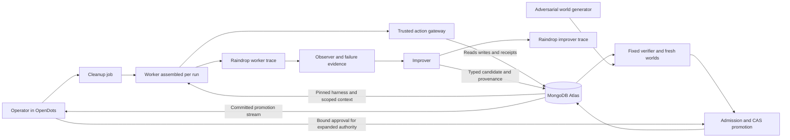

# Recursive Self Improvement Hackathon Recommendation

Prepared 11 October 2026 for the Harness Engineering and Model Wrangling event at Shack15. The builder is one human working with Codex agents. This recommendation preserves the ambitious scope and evaluates OpenMuse, OpenBot and OpenDots as reusable foundations.

## The project to build

**Expunge: a database cleanup agent that learns where records hide, changes its own workflow, and earns its completion claim through a database receipt.**

A company asks an agent to remove a synthetic customer from its registered MongoDB data. The agent removes the obvious record but misses a nested reference or a record linked through an account. It reports success. Raindrop captures the interaction and failure evidence. An improver reads the actual trace, discovers the deficient context or traversal policy, and proposes a new executable harness. A fixed verifier tests the proposal in fresh worlds, including unrelated records that must survive. MongoDB promotes the passing version atomically. The same model then succeeds on a different customer and a different arrangement of the data.

The visible product is a cleanup request and its evidence: records found, records changed, surviving references, protected records and a completion receipt. The interface makes the changing procedure visible while the agent does useful work.

The full ambition includes four evolving surfaces—context policy, workflow, guardrails and tool access—plus an adversarial data generator, persistent regression cases, human approval for authority expansion, and a measured experiment on an evolved improver. Codex can build these in parallel. Their integration should converge on one end-to-end learning loop and one clear three-minute story.

Use synthetic identities and registered data scopes for the demonstration. A successful fixture test establishes correctness for that test world. An operational receipt establishes coverage of the declared schema and revision. Neither establishes universal discovery of personal data or compliance with a privacy law.

**Suggested spoken line:** “It keeps the procedure, then proves the cleanup.”

## Event and evidence corrections

The user confirmed this is the Shack15 event. The [organizer listing](https://cerebralvalley.ai/e/mongodb-sftw-hackathon) gives **Sunday 11 October 2026, 9 AM to 10 PM PDT**. That begins at **9:30 PM on 11 October in India**. The workspace participant guide gives a 10:30 AM to 5 PM build window: **11 PM on 11 October to 5:30 AM on 12 October in India**. Use the official event date; the local guide supplies the working schedule assumption.

The existing reports contain valuable research, proposed architectures and simulated judge panels. Their votes, scores and imagined judge quotations are design exercises, not actual judging evidence. This recommendation does not use those scores to predict placement. Claims about why a past project won remain interpretations unless an organizer published a rationale.

The local [builder guide](research/notes/00-mongodb-builder-guide.md) requires the Atlas Hackathon Sandbox for finalists and states that prior projects are prohibited and work must be original. MIT licensing answers whether copying is legally permitted; it does not settle event eligibility. A complete existing-app fork needs an organizer ruling before being represented as an eligible original submission. The architectural plan remains usable through attributed framework components and newly authored domain, evolution and verification modules. Keep a built-during-event record and identify all reused code.

## What the winner research actually establishes

The fresh search found **one corroborated Raindrop AI sponsor-track winner**, Agent in the Loop / autoresearch-observers. The [May 30 organizer event](https://luma.com/fvz1h1dq) advertised a $5,000 Workshop prize. An [employer announcement](https://x.com/ZipEngineering/status/2061601101955453183) says its team won the Raindrop track and links the [project repository](https://github.com/Vincen-Le/autoresearch-observers). The repository demonstrates Workshop traces, an observer, steering and a modified trace interface. An organizer results announcement was not located. This supports a corroborated track win; it does not establish overall first place, payout or an exhaustive inventory of winners.

Many other “Raindrop winner” results concern **LiquidMetal AI's Raindrop**, a different backend product. The [Self Evolving Agents contest](https://self-evolving-agents-hack.devpost.com/) explicitly identifies that provider. Its SmartMemory and SmartSQL integrations cannot be counted as Raindrop AI observability precedent.

| Project or comparison | Supported conclusion | Implication for Expunge |
|---|---|---|
| Agent in the Loop | Corroborated Raindrop-track win; real runtime observation and steering. Persistent harness learning was not established by the fresh public evidence. | Turn trace evidence into a retained, tested change, and observe the improver as well as the worker. |
| [VERITAS](https://github.com/ElijahUmana/VERITAS) | A relevant public implementation of governed promotion and evidence read-back; placement was not verified. | A gate plus an audit interface already has close prior art. The data-cleanup artifact and schema transfer must carry the differentiation. |
| RustForge and other Raindrop-associated entries | Participation or intended integrations do not establish winning or working integration. | Map every product claim to an actual code path and a recorded outcome. |
| Ripple at the prior MongoDB harness event | The [official gallery](https://cerebralvalley.ai/e/mongodb-nyc-hackathon/hackathon/gallery) lists its project, and its [design](https://github.com/jovianw/ripple/blob/main/DESIGN.md) documents hidden checks, a versioned harness, a gate and held-out comparison. The fresh pass could not retrieve the organizer's LinkedIn placement announcement. | Adopt independent verification and same-model comparison. Treat its small benchmark as team-reported evidence, not a performance promise. |
| Offload at the prior event | Its [repository](https://github.com/SpectrrT/MongoDB_HarnessHack) implements the Replay Evolve Merge concept and documents failed trials and evaluation limitations. | Preserve failed candidates and benchmark provenance. Durable execution is useful, but does not establish improved learning by itself. |

The actionable hypothesis from this small evidence base is that Raindrop should be part of the working feedback path. There is insufficient evidence to claim a universal winning formula. The [fresh winner audit](research/fresh-raindrop-winners.md) contains the searches, named candidates, source confidence and remaining gaps.

## Research that should shape the implementation

The fresh literature audit covers 16 anchors, multiple semantic search framings, two related-paper expansions and nine paper-body checks. These are reported research findings, not reproduced experiments. Most recent papers are preprints.

| Primary paper | Useful result or mechanism | Consequence |
|---|---|---|
| [STOP](https://arxiv.org/abs/2310.02304) and [Hyperagents](https://arxiv.org/abs/2603.19461) | The improvement program or meta-agent can itself be editable. Frozen models can participate in this process. | Version the improver separately from the worker and retain a fixed outside evaluator. |
| [RRSI](https://arxiv.org/abs/2609.24972) | Restricts proposal complexity and uses critique/pruning. Its current abstract and retrieved body contain different revision-level headline maxima. | Favor small, reusable edits and record the source revision; avoid task IDs and answer literals. |
| [ModularRSI](https://arxiv.org/abs/2609.14857) | Uses contrasting trajectories and separate harness modules. This pass verified the abstract. | Show which module changed and require a deficiency that appears across more than one case. |
| [Self Healing Harness](https://arxiv.org/abs/2609.24130) | Its body reports 383 rejected proposals, including 211 that fixed the trigger but regressed protected behavior. | A real fix can be harmful. Fresh protected-case execution belongs inside promotion. |
| [Phantom Guardrails](https://arxiv.org/abs/2607.13083) | A deterministic micro-lab shows useless guards can ride inside otherwise improving edits. | Each edit must cite evidence and demonstrate its own effect. The paper is not a general safety proof. |
| [VERSE](https://arxiv.org/abs/2610.02616) | Its motivating table reports 39.20% fixed baseline, 31.79% self-evolution without verification and 41.05% self-evolution with verification. The rows use one evolution run, with additional verification cost. | A convincing generated patch is insufficient; execute it and count its cost. |
| [FreeEvolve](https://arxiv.org/abs/2610.09197) | Tests a learned evolution skill on fresh base workers. Its reported campaigns use substantial compute. | Test the evolved improver by the worker it creates from a reset base, under the same budget as the original improver. |
| [AIDE squared](https://arxiv.org/abs/2609.26457) | The authors describe their improver-versus-baseline advantage as inconclusive given noise and costly additional evaluations. | A null second-order result is credible. Do not substitute a growing test suite for measured improvement of the improver. |

The defensible primary claim is **bounded harness self-improvement**. A failure changes the executable environment around a fixed model. Stronger recursive improvement requires the additional fresh-base experiment. Neither claim means improved model weights or indefinitely accelerating intelligence. The [full fresh literature audit](research/fresh-rsi-literature.md) distinguishes body checks from abstract-only evidence and lists foundational work including Promptbreeder, ADAS, SICA and the Darwin Gödel Machine.

## Why this project rather than the alternatives

| Direction | Strength | Reason for its place in the recommendation |
|---|---|---|
| **Expunge** | The failure and the outcome are visible in the database; unfamiliar schemas give a meaningful transfer test; MongoDB is the task environment. | Recommended product. Its coverage boundary must stay explicit. |
| **SpotterDB** | A correction becomes a durable tool prerequisite, such as archive evidence before deletion. | Useful control mechanism to incorporate. A single archive-before-delete rule is already solved by an expert-written transaction, so it needs a harder transfer demonstration. |
| **CaseLaw** | Rich authority controls, as-of replay, precedent and audit. | Use its governance inside Expunge. Its architecture alone does not establish useful learning, and replaying recorded actions does not predict new agent actions. |
| **DROSTE** | Directly tests improvement of an improver on a domain benchmark. | Strong research angle. Domain correctness and benchmark preparation add a separate dependency, while MongoDB is less intrinsic to the task. |
| **TrollBooth** | Real people supply adversarial interactions and the output is tangible. | Strong experiential demonstration, with additional speech and human-traffic variance. |

These are engineering judgments. They are not simulated placement probabilities or real judge endorsements.

## Using OpenDots OpenBot and OpenMuse

**Recommended combined architecture: OpenDots for the operator shell, its included OpenBot execution services, and a new MongoDB governance and learning backend.** OpenDots and OpenMuse both already construct tools and prompts per run. Add Atlas-pinned harness loading at that existing seam. OpenMuse supplies useful alternative provider/state-streaming helpers and durable-worker patterns. Keep native chat/workspace persistence where convenient. MongoDB owns the domain, job checkpoints and all authoritative improvement state.

The current repository snapshots checked by the researchers are OpenDots `625452e`, OpenMuse `1ac68f3` and OpenBot `a4dce8c`. OpenDots' bundled computer deployment pins an earlier OpenBot commit, `b6932d3`; it is not automatically the current OpenBot application. Pin exact snapshots at build time; this is a fast-moving alpha ecosystem. The CopilotKit skill's package versions are older than these repositories, so its version numbers should not be copied into the project without checking compatibility.

| Foundation | Concrete use | Work that Expunge must add |
|---|---|---|
| [OpenDots](https://github.com/CopilotKit/OpenDots) | Operator conversation, background task runner, review cards and an existing OpenBot supervisor client. Its [approval route](https://github.com/CopilotKit/OpenDots/blob/625452e06cde74cb25b0ce319e2c1be0488f5a5f/src/server/connection-routes.ts#L113) executes server-stored tool/arguments after approval. | MongoDB-backed domain job store; harness loading; evolution queue; verification gate; atomic promotion. Its existing SQLite approvals cannot atomically authorize an Atlas promotion. |
| [OpenBot](https://github.com/CopilotKit/OpenBot) | Policy evaluation before action, audit before/after, and policy dry-run over historical decisions. OpenDots already has computer-service wiring. | Adapt the gateway to MongoDB tool actions and migrate authoritative audit/approval records. Its computer policy does not automatically intercept unrelated database MCP calls. The gateway is not a drop-in isolated function. |
| [OpenMuse](https://github.com/CopilotKit/openmuse) | Its per-run construction is also present in OpenDots. Its TanStack wrapper, provider routing, AG-UI state helpers and durable task worker are useful components or implementation references. A remote AG-UI agent can replace its conversational backend. | Select compatible helpers rather than adding another complete runtime; load a pinned Atlas bundle; define the domain tools and trusted scope; emit only committed changes. A running-state UI flag is not durable execution or RSI. |

OpenDots is the strongest foundation when the operator, approvals and actual OpenBot computer integration matter. OpenMuse is a viable alternative shell when its personal-workflow UX is preferable. Its current README marks OpenBot integration as future work, so direct OpenMuse-to-OpenBot composition needs additional engineering. OpenMuse's external-agent configuration is `AGENT_BACKEND=agui`, `AGENT_URL` and optional `AGENT_TOKEN`; this is not an invented `AG_UI_URL` environment variable.

The [bundled OpenDots/OpenBot computer stack](https://github.com/CopilotKit/OpenDots/blob/625452e06cde74cb25b0ce319e2c1be0488f5a5f/deployment/computers/README.md) is useful for isolated self-editing or visible computer work. For database operations, the trusted Mongo gateway remains the actuator. OpenBot's MCP policy context does not currently include arbitrary arguments or database receipts, and its policy callback is synchronous; stateful prerequisites belong in our async gateway. Do not assume native [Dot-to-Dot delegation](https://github.com/CopilotKit/OpenDots/issues/71): Expunge must explicitly route investigator, worker, verifier and improver jobs.

The app source is MIT; retain license notices and attribution for copied code. CopilotKit Intelligence is a separate service with its own access terms. Current OpenMuse startup requires its Intelligence key even in external-agent mode; the proposed local-threads alternative was not merged in the inspected snapshot. OpenDots also needs Intelligence for stock conversation flows. Confirm accounts and startup before relying on either shell. A common protocol does not make their stores, schedulers and approval formats interchangeable.

The detailed integration audits are [OpenMuse](research/fresh-openmuse-integration.md), [OpenBot](research/fresh-openbot-integration.md) and [OpenDots](research/fresh-opendots-integration.md).

## The complete architecture

### Task world and truth

Start with customers, accounts, messages and events. The generator places a synthetic subject in direct fields, nested arrays and indirect account references, alongside unrelated records and namesakes. It independently creates a sealed evaluation manifest of target record IDs/fields and preservation hashes. The worker and improver cannot query that manifest.

The full product can support owner-defined eligibility policies and several effects: delete, redact, restrict or tombstone. Those policies remain outside the editable harness. Learning changes how eligible copies are discovered and handled; it cannot redefine which records the owner authorized it to change. A structural lesson can survive a cleanup without copying the subject's literal identity into the learned bundle. Test that property in the generated artifacts rather than claiming universal absence of information leakage.

Expose generic schema inspection, exact-identity search, relationship traversal, preview and scoped change operations. Schema and relationships must be derived from the visible data or declared registry. The worker should not receive a fixture-specific list of all answers.

**Separate two proofs:** the hidden evaluation manifest measures actual cleanup and collateral damage in the test world; the operational receipt checks the declared/discovered scope and data revision. The receipt service must not silently use the hidden answer key. A scope can be incomplete; the independent grader should reveal that. This distinction keeps the learning demonstration honest.

### Editable harness

Treat the following as a versioned bundle, with a content hash and parent hash:

- **Context policy:** which schema observations and previous failure lessons reach the worker, how references are expanded, and how context is bounded.
- **Workflow:** schema inspection, identity resolution, discovery, preview, execution, verification and reporting edges.
- **Guardrails:** preservation checks, retry/idempotency requirements, and whether a specific action requires an approval or receipt.
- **Tool access:** which preauthorized tools appear in the run and the prerequisites for executing them.
- **Limits:** calls, traversal depth, documents per batch and compute budget.
- **Evidence:** source trace IDs, candidate hypothesis, evaluation IDs and parent version.

Use typed, composable operators or a bounded AST. An improver can compose and parameterize them from observed schema facts. If its vocabulary is fixed by humans, say so. The contribution is learned composition and measured transfer; it is not unrestricted invention of infrastructure. If sandboxed source edits are added, retain the same external verifier and authority boundary.

### Raindrop's working role

Instrument both the worker and improver. Attach run, parent, candidate and evaluation identities. Read back real signals and traces to the observer; source the evolution job from that evidence and write the final accepted/rejected outcome back to the same evidence chain.

Distinguish detector origins. An SDK self-diagnostic is the agent's hypothesis. A tracked verifier-failure signal is feedback from our verifier. A vendor-generated classification is Raindrop's classification. Passing feedback through Raindrop does not turn it into independent detection. A wrong-success or frustrated-user signal can contribute evidence the database outcome alone lacks; compare a trace-informed proposal with a score-only or wrong-incident proposal to test whether that evidence helps.

The [SDK](https://raindrop.ai/docs/sdk/typescript) supports task interactions, signals and feature flags. [Self Diagnostics](https://raindrop.ai/docs/platform/self-diagnostics) has a real reporting tool that the agent loop must dispatch. [Query REST](https://raindrop.ai/docs/query-api/api-reference) reads events, traces and signals; Issues are available through [MCP](https://raindrop.ai/docs/mcp/overview), rather than an invented REST Issues endpoint. Issues and Experiments require Pro access. Measure ingest-to-read latency; no guaranteed live latency was established. A pre-recorded genuine incident can remain the stage trigger while the candidate evaluation runs live, with the replay identified accurately.

### Admission and execution boundary

1. The candidate cites an actual incident and a hypothesis.
2. Database validation rejects invalid shapes, forbidden tools and out-of-range budgets.
3. Historical decision replay identifies likely regressions and authority changes.
4. Fresh parent/candidate runs establish behavior, using identical initial worlds, model settings and budgets.
5. Protected cases test unrelated records, legitimate cleanup and necessary retries.
6. The trusted promoter rechecks the tested parent and approval scope, then commits the active harness pointer, consumed approval and promotion receipt in one transaction. Operational cleanup changes and their idempotency/effect receipts use separate execution transactions.
7. New runs load the new bundle; active runs retain their original pinned version.

The improver cannot alter the oracle, verifier, authority floor, credentials or promoter. An authority expansion needs a server-stored, expiring approval bound to the exact proposal and affected scope; the server re-derives that scope before committing. Implement this in Atlas so it can participate in the same transaction as promotion. Add a unique consumed approval/proposal ID and bind the grant to the parent harness and scope revision. Upstream OpenDots deduplicates receipts by thread/tool-call ID and does not store the harness version; that alone does not establish once-only promotion per proposal. OpenDots supplies the interaction pattern, not the completed cross-store protocol.

Historical replay holds observed actions fixed. It cannot establish how a different tool graph changes future agent behavior. Fresh execution is therefore required even when replay is sophisticated.

## How MongoDB is integrated deeply

| MongoDB mechanism | Central responsibility | Evidence and limitation |
|---|---|---|
| Domain collections and indexed joins | Store the actual records being discovered and changed. Use `$lookup`, or `$graphLookup` over a derived relationship-edge collection, for meaningful identity traversal. | Relation edges must come from visible facts, not the hidden grading manifest. A traversal operator does not discover arbitrary semantic identity by itself. |
| Validated, insert-only harness versions | Store executable context/workflow/tool policy plus provenance. | [Schema validation](https://www.mongodb.com/docs/manual/core/schema-validation/specify-json-schema/) checks documents; restricted permissions are needed for immutability and prevent validation bypass. |
| Scoped principals | Separate proposal writing, task execution and hidden grading truth. | [Atlas custom roles](https://www.mongodb.com/docs/atlas/security-add-mongodb-roles/) require account rights. Without them, accurately describe application-enforced isolation. |
| Transactions and effect ledger | Commit batch mutations, unique idempotency records and receipts together; atomically promote a tested candidate. | [Node transactions](https://www.mongodb.com/docs/drivers/node/current/crud/transactions/) retry callbacks; keep network/model calls outside them and use one client's session sequentially. External effects are not magically exactly-once. |
| Compare and set deployment pointer | Reject promotion from a stale parent and record rollback lineage. | [Atomicity](https://www.mongodb.com/docs/manual/core/write-operations-atomicity/) supports expected-value filters. A unique partial index gives at most one active row, not existence of an active version. |
| Aggregation over evaluation rows | Compute success, residuals, preservation failures, refusals and cost by pinned version. | Immutable paired rows keep comparison auditable. Window functions can support bounded history features; a large custom temporal compiler needs its own correctness checks. |
| Change stream over promotion inserts | Update the operator view only after commit; resume from a token when claiming restart recovery. | [Change streams](https://www.mongodb.com/docs/manual/changeStreams/) are committed event delivery. An `updateLookup` image need not be the historical image at the event's instant. |
| Failure retrieval and lineage | Recall relevant schema lessons and navigate version ancestry. | [Vector Search](https://www.mongodb.com/docs/vector-search/query/aggregation-stages/vector-search-stage/) retrieves evidence; it is not the authority or correctness check. Split and tenant filters prevent evaluation leakage. |
| Checkpoints and leases | Recover a cleanup/evaluation job without reapplying its recorded effects. | Durable job state belongs in Atlas even if the operator shell keeps chat preferences in SQLite. |

This is not feature counting: removing Atlas breaks the task environment, verification receipts, version authority and deployment protocol. A replaceable chat store in another database does not weaken that role.

Check the sandbox tier early. [Atlas Free limits](https://www.mongodb.com/docs/atlas/reference/free-shared-limitations/) include 100 operations per second, 50-stage pipelines, no disk spill and a 32 MB sort limit. A general-server limit is not an Atlas Free limit. Search freshness and account-specific embedding quotas must not sit on the authority path. The [fresh technical audit](research/fresh-mongodb-raindrop-architecture.md) records API contracts, example request shapes and caveats.

## The demonstration

One incident should carry the whole story:

1. **Before:** a cleanup finishes, but the world view shows a surviving nested or indirect reference. Show the actual model output and actual data. Demonstration counts are measured outputs, not scripted research promises.
2. **Evidence:** open the linked Raindrop interaction. The improver proposes a visible change to schema context and workflow/tool prerequisites.
3. **Trial:** display paired parent/candidate outcomes for the incident, a protected namesake, a legitimate cleanup and an unseen schema composition. Show one rejected unsafe or overbroad candidate.
4. **Commit:** the version hash changes after an Atlas promotion transaction. A completion action now needs a verified receipt. The run uses the same model.
5. **After:** clean a new synthetic subject in the withheld shape; show residuals and protected records. Finish with the independent evaluation table and an optional improved-improver result if actually measured.

Expose the product first. Detailed lineage, replay, controls and source evidence support Q&A. A genuine saved run is a useful fallback and must be visibly identified as a replay. Preserve the ability to reset the world without deleting benchmark evidence.

## Evaluation that can survive questions

Freeze fixture seeds and split assignments before evolution. Training should include more than one structural miss. Held-out cases should change **path shapes and relationship composition**, not merely customer IDs. Include nested arrays, two-hop references, cycles/duplicate edges, unrelated namesakes, missing links and interrupted batches with retry. Admit a fixture only when a reference solution satisfies its independently generated manifest.

Compare four conditions on the same held-out worlds:

| Condition | Purpose |
|---|---|
| Initial harness | Establish baseline behavior. |
| Expert static harness | Establish whether a competent predefined procedure already solves the task. |
| Evolved harness | Measure improvement from the incident-driven change, using the same model. |
| Score-only or wrong-incident evolution | Test whether the trace contributed useful information rather than a generic rewrite. |

Task success requires all targeted changes, preservation of unrelated records and truthful status. Blanket deletion fails preservation; blanket refusal fails useful completion. Record task counts, per-case outcomes, residuals, collateral changes, false refusals, calls, latency and total worker/observer/improver tokens. Repeated runs reveal stochastic failures; report the small sample plainly rather than implying statistical certainty.

For the full second-order experiment, freeze improver versions I0 and I1. Reset two workers to identical W0. Give both improvers the same new evidence and compute budget. Grade the workers they produce on a further withheld world. Repeated I0-versus-I0 trials estimate noise. The evaluation unit is the **worker produced**. An expanding regression corpus or a better improver explanation is insufficient. Report a null result if I1 does not outperform I0.

The adversarial generator can then evolve new data layouts, constrained by a reference-solver admission test and a fixed resource budget. Its job is to find valid hard worlds, not create impossible tasks or change the correctness criterion. Its manifests remain sealed from the production worker and improver.

## Building with Codex agents

Keep the ambitious architecture and divide by interfaces and file ownership. A coordinating Codex agent can run three build agents concurrently, then integrate and review their outputs. More parallel implementation makes contract discipline more valuable.

| Lane | Ownership | First integration artifact |
|---|---|---|
| World and verifier agent | Synthetic worlds, identity relations, sealed manifests, preservation hashes, fixture admission, train/test splits, adversarial generator. | A reference cleanup and a failing baseline graded by data. |
| Runtime and MongoDB agent | Scoped tools, trusted gateway, receipts, idempotent batches, validators, principals, checkpoints and run pinning. | One job executes and resumes on Atlas with an auditable receipt. |
| Operator and Raindrop agent | Chosen CopilotKit shell, AG-UI state, proposal/approval cards, worker/improver instrumentation, evidence read-back, committed stream. | A real run visible in both the product and Raindrop with matching IDs. |
| Coordinating agent | Contracts, evolver, historical replay, fresh-run admission, CAS promotion, meta-improver comparison, deployment and rehearsal. | One candidate is accepted and one is rejected with reproducible evidence. |

Freeze contracts for WorldSpec, CleanupJob, HarnessBundle, ActionReceipt, Candidate, EvaluationRow, Approval and Promotion. All lanes should use the same run IDs, world IDs, parent hashes and status meanings. Keep the hidden oracle interface narrow. Integration should happen against a real Atlas world, not independently invented mock contracts.

Milestones are a build sequence, not a reduction in scope:

- At kickoff, verify sandbox rights, shell startup, SDK calls and Raindrop read-back; pin dependencies and snapshots.
- Get baseline task execution and grading connected first.
- Connect real failure evidence to a typed candidate and fresh evaluation.
- Complete atomic promotion and demonstrate a newly pinned run.
- Add protected cases, authority approval, adversarial worlds and the fresh-base meta experiment in parallel against the working spine.
- Freeze the model, verifier and artifact hashes before final evaluation; rehearse the three-minute path, record the one-minute submission and preserve evidence.

The unavoidable bottlenecks are service access, integration, sequential evaluation latency and rehearsal. Plan for them explicitly while retaining the requested ambition.

## Research record and remaining uncertainty

New source evidence is saved under the ignored `.firecrawl/` directory. Fresh sub-reports cover papers, winners, technical contracts and each CopilotKit application. Search and scrape were used for event/project sources; the separate paper index was used for semantic discovery, related-paper expansion and load-bearing body verification. Indexed developer search and source files were used for repository behavior. LinkedIn sometimes blocked retrieval; those failures are preserved as evidence limits. No claim is made to have exhaustively searched the whole web.

Unresolved items that affect execution are full-fork eligibility, actual sandbox privileges/tier, CopilotKit Intelligence access, Raindrop account features and ingest latency, and measured application/evaluation performance. These are setup probes and acceptance checks in the plan. No application was built and no proposed success numbers were measured during this research.

