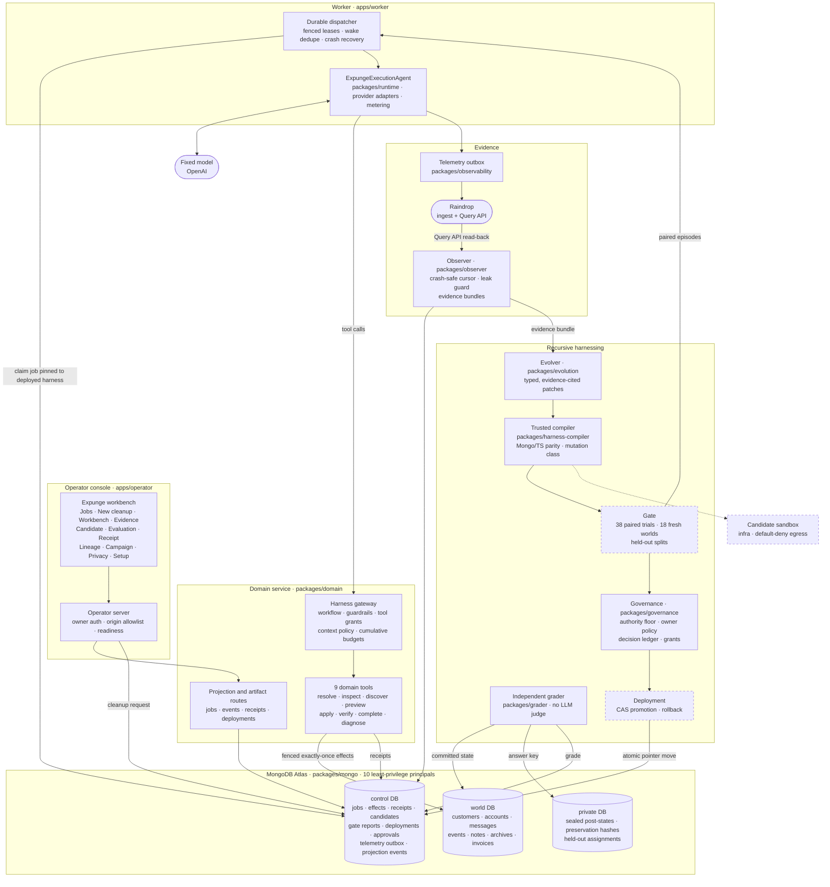

<div align="center">

# Expunge

**A database-cleanup agent that rewrites its own harness from measured failures, and has to prove every cleanup to MongoDB.**<br/>
A fixed OpenAI model deletes one person's records from a MongoDB dataset. An independent grader, with no LLM judge, counts the copies it missed and any data it damaged. Raindrop traces of that run become the evidence for a typed change to the agent's own harness: its context policy, workflow, guardrails and tool access. The change is tested against its parent on fresh paired test datasets, and MongoDB promotes it only if it cleans more **and** damages nothing it must keep.

[](#hackathon-submission)
[](#mongodb-the-authority-layer)
[](#raindrop-evidence-for-the-improver)
[](#how-it-works)

[](#the-harness-what-evolves)
[](packages/domain/src/tools)
[](docs/expunge/DATA-MODEL.md#principals)
[](packages/harness-compiler)
[](packages/grader)
[](#project-status)
<br/>
[](tsconfig.json)
[](.nvmrc)
[](packages/mongo/package.json)
[](packages/observability/package.json)
[](apps/operator)
[](vitest.config.ts)
[](#built-to-fail-closed)

[Hackathon](#hackathon-submission) · [How it works](#how-it-works) · [Architecture](#architecture) · [The harness](#the-harness-what-evolves) · [MongoDB](#mongodb-the-authority-layer) · [Raindrop](#raindrop-evidence-for-the-improver) · [Quick start](#quick-start) · [Status](#project-status) · [Docs](#documentation)

</div>

> **Status at submission (11 October 2026).** Nothing has yet run against a live model or live Raindrop, and no cleanup job has run on Atlas. So far the loop has run only with clearly labelled fakes on local MongoDB replica sets, and every harness candidate came from a labelled fake proposer or was written by hand. The gate and deployment services are still being merged (a gate rebuild is in [PR #1](https://github.com/nihalnihalani/expunge/pull/1)). Credentials for OpenAI, Raindrop and an Atlas cluster are configured, and the first live run is next. Evidence: [Project status](#project-status) and [WHAT_IS_REAL.md](WHAT_IS_REAL.md).

## Why Expunge

Deleting one person from a real company database is harder than it looks. Their records hide in nested arrays, aliases, indirect references through accounts, and reference cycles. They sit next to namesakes who must not be touched and next to records that must be retained, such as invoices. Agents asked to clean this up often report success while copies remain.

Expunge treats that failure as the training signal, under three rules:

- **Completion is checked, not claimed.** An independent grader compares the committed database state with a sealed manifest the agent can never read. It counts what was left behind and what was damaged. There is no LLM judge.
- **The harness evolves, not the model.** The model stays fixed. What changes is its harness: context policy, workflow graph, guardrails and tool access. Each change is a typed, evidence-cited patch that a trusted compiler can check.
- **MongoDB holds the authority.** A candidate harness is admitted only by fresh paired trials against its parent. It is promoted only by an atomic compare-and-swap that consumes a bound human grant when authority expands. A version that cleans more but breaks protected or unrelated data is rejected.

## Hackathon submission

| | |
|---|---|
| **Event** | Harness Engineering & Model Wrangling Hackathon · Shack15, San Francisco · 11 October 2026 |
| **Track** | Statement One: **Recursive Harnessing**. The agent rewrites its own rules, context policy, guardrails and tool access from measured failures. |
| **MongoDB Atlas** | The authority layer: three databases, ten least-privilege principals, fenced exactly-once effects, compare-and-swap promotion, change streams. Proven on local replica sets; schema set up on the Atlas Hackathon Sandbox |
| **Raindrop** | The evidence layer: model and tool traces, read back through the Query API, are what every harness change must cite |
| **New work** | [BUILT_DURING_EVENT.md](BUILT_DURING_EVENT.md) separates prepared research, imported open-source foundations and the new Expunge code from the build session, commit by commit. Notices for imported components are in [THIRD_PARTY.md](THIRD_PARTY.md) |
| **Team** | [@nihalnihalani](https://github.com/nihalnihalani) · [@charliegillet](https://github.com/charliegillet) |

How Expunge maps to the judging criteria:

- **Technical demo.** The demo is the loop itself, not a dashboard: a cleanup run, the grader's verdict on what it missed, the Raindrop evidence a harness change must cite, the compiler's verdict on that change, and the candidate's paired comparison with its parent. Every step is stored state in MongoDB, and the operator console is only a view onto that state. So far this has run only with labelled fakes on local replica sets (see [Project status](#project-status)).
- **Implementation difficulty.** Ten least-privilege MongoDB principals, fenced exactly-once effects, transactional promotion that consumes a bound human grant, and a trusted harness compiler whose guardrails evaluate identically in TypeScript and MongoDB, with 61 rejection codes. The paired-trial gate, which holds out validation, protected and final splits, is being merged in PR #1.
- **Impact.** Every organization that stores personal data eventually has to delete some of it. Expunge turns "deleted" into a verified, receipted claim, and improves its own procedure without weakening protections.
- **Creativity.** The agent's harness evolves, not its weights, under a dual constraint: clean more, and damage nothing that must be kept. A harness change counts only if it cites the evidence behind it.

## How it works

| | Step | Powered by |
|---|---|---|
| **1** | **Request.** The owner asks for a subject to be cleaned. The job is created already pinned to the currently deployed harness version. |   |
| **2** | **Clean.** The worker runs the fixed model through a gateway that enforces the harness. It exposes nine domain tools, from resolving the subject and discovering references to previewing, applying and verifying each batch. Every write is a fenced, exactly-once MongoDB transaction with a receipt. |   |
| **3** | **Grade.** The independent grader reads committed state and a sealed manifest. It reports targeted residuals, retention and preservation violations, unrelated-record changes, and whether the completion claim was truthful. |  |
| **4** | **Trace.** Model and tool spans flow through a transactional outbox to Raindrop. The observer reads them back through the Query API into a leak-guarded evidence bundle. |  |
| **5** | **Propose.** The evolver writes a typed patch to one harness surface and cites the evidence IDs behind it. The trusted compiler validates it, classifies the authority change, and replays past decisions against it. | Expunge evolution + compiler |
| **6** | **Gate** *(being merged, PR #1)*. Parent and candidate run as 38 paired trials on 18 fresh worlds (train 2×3, protected 8×2, validation 8×2) with the same model, budget and fault plan. The final split is never read. Admission needs at least two extra successes on the six training pairs, zero candidate retention or preservation violations, no protected world where the candidate succeeds less often than its parent, and no drop in validation successes. |  |
| **7** | **Promote** *(deployment service being merged)*. An admitted candidate moves the deployment pointer in one MongoDB transaction, consuming a human grant when its authority class requires one. The next job is pinned to the new harness, and rollback is a stored receipt. |   |

## Architecture



<sub>Dashed boxes are work in progress and not yet on `main`: the gate and deployment services (a gate rebuild is in PR #1) and sandboxed plugin execution.</sub>

### One turn of the loop


## The harness: what evolves

A harness is a typed bundle. A patch names one surface and path, and carries its `before` (re-derived from the parent), `after`, hypothesis and cited evidence IDs. Before it can reach the gate, it must pass schema, citation, apply and compile checks, plus a replay against recorded past decisions.

| Surface | Patch paths | Enforced at run time by |
|---|---|---|
| **Context policy** | `contextPolicy.schemaMode`, `includeNestedArrays`, `referenceDepth`, `lessonRecall`, `maxContextTokens`, `evidenceFormat` | Domain tools: field visibility, nested-array traversal, reference depth |
| **Workflow** | `workflow`, `completionPolicy` | Gateway workflow graph: which tool may follow which, and what completion requires |
| **Guardrails** | `guardrails.<ruleId>` | Three-valued rules (allow, deny, ask) evaluated identically in TypeScript and MongoDB expressions |
| **Tool access** | `toolPolicy.grants`, `toolPolicy.prerequisites`, `limits.<limitKey>` | Session tool grants, prerequisites and structural limits such as traversal depth |
| **Plugins** | `pluginArtifacts` | Compiled sandboxed plugins: hashed today, invocation in progress |

Example patches from the test suite include widening discovery (`includeNestedArrays=true`, `referenceDepth=5`, traversal limit 5, classed *behavioral*) and adding a guardrail that denies `complete_cleanup` until verification is valid (classed *tightening*). The compiler computes each patch's mutation class, and that class decides whether promotion needs a human grant. The proposer's own claim about the class is never used.

<sub>`lessonRecall`, `maxContextTokens` and `evidenceFormat` are patchable but not yet consumed at run time.</sub>

## MongoDB: the authority layer


MongoDB is the system of record for both the data being cleaned and the authority to change the agent.

- **Three databases.** `world` holds the business records under cleanup. `control` holds jobs, intents, effects, receipts, candidates, gate reports, deployments, approvals and the telemetry outbox. `private` holds the answer key: expected post-states, preservation hashes and held-out assignments. Only its creator and the grader can read it.
- **Ten least-privilege principals:** setup, domain executor, observer, proposer, grader, approval issuer, promoter, projection reader, privacy controller and fixture builder. Each has an explicit list of what it must not be able to do; the proposer, for example, cannot read private truth or move a deployment ([data model](docs/expunge/DATA-MODEL.md#principals)).
- **Fenced, exactly-once effects.** Jobs are claimed with fenced leases. Each logical effect commits once, with its intent and receipt, inside a transaction. A zombie worker with a stale fence cannot write.
- **Atomic promotion.** Promotion compare-and-swaps the active harness pointer and consumes a bound, single-use human grant in the same transaction. Rollback is a stored receipt, and refused rollbacks are recorded too.
- **Pinned execution.** A job is created and claimed only against the harness version currently deployed for its scope; any other version is refused.
- **Change streams with recovery.** Projection streams carry per-job epochs. A corrupt resume token triggers snapshot-and-backfill instead of silent gaps.
- **Validators and RBAC.** Strict JSON-schema validators guard control and private collections, and per-principal RBAC denials are tested on local replica sets.

## Raindrop: evidence for the improver


Raindrop is how a failure becomes evidence the improver can cite. That makes it the engine of recursive self-improvement.

- **Tracing.** The worker emits model and tool spans with the `raindrop-ai` SDK. Untrusted model narrative is labelled as such.
- **Transactional outbox.** Telemetry is first committed to an outbox in MongoDB, then delivered at least once with distinct delivery states, so a Raindrop outage does not lose evidence.
- **Read-back.** The observer reads events back through the Raindrop Query API with a crash-safe cursor, applies subject suppression and a leak guard, and assembles evidence bundles.
- **Cited proposals.** Every harness patch must cite evidence IDs from a bundle, and a citation check rejects patches that cite evidence outside it.

## Built to fail closed

- **Fake evidence cannot admit.** In the gate (rebuild in PR #1, not yet on `main`), scripted models, simulated workers and labelled fake read-backs can only ever produce `hold` with `fake_evidence`. Every simulated artifact is labelled FAKE.
- **No self-grading.** The grader has no model judge, and the agent and proposer cannot query the answer key.
- **No re-rolls.** The same gate allows one campaign per parent and candidate. Failed, cancelled and timed-out runs count as non-successes.
- **Approvals bind exactly.** An approval is keyed to the proposal and its digest. The button grants permission; it never claims a promotion happened.
- **Honest receipts.** An incomplete cleanup gets an incomplete receipt, and the operator console shows the model's narrative as unverified.
- **Isolated candidates.** The candidate sandbox is a container with default-deny egress, DNS drop and broker-minted run tickets.

## Quick start

Requirements: Node `>=24.13.1 <25` or `>=25.4.0` (`.nvmrc` pins 24.13.1), npm and Docker.

```bash
npm ci
npm run typecheck
npm run lint
npx vitest run          # deterministic logic and configuration checks
```

Mongo protocol tests run against a local replica set:

```bash
docker compose -f packages/mongo/test/docker-compose.yml up -d
MONGODB_TEST_URI='mongodb://127.0.0.1:27018/?replicaSet=expunge-local&directConnection=true' npx vitest run packages/mongo/test
```

RBAC denial tests use a separate authenticated replica set: `docker compose -f packages/mongo/test/auth-docker-compose.yml up -d`, then set `MONGODB_RBAC_TEST_URI` as described in [docs/MONGO.md](docs/MONGO.md).

Operator console:

```bash
npm ci --prefix apps/operator --workspaces=false
node apps/operator/scripts/run-from-root.mjs dev     # then open #/expunge
```

Configuration: copy `.env.example` to `.env` and fill the values locally, one connection URI per least-privilege MongoDB principal (`MONGODB_<PRINCIPAL>_URI`). The operator console reads its own `.env.operator` and refuses to start if any `MONGODB_*` credential is in its environment. Variable names are documented in [docs/ENVIRONMENT.md](docs/ENVIRONMENT.md). Never commit credentials. Every live-service suite skips without its connection string and fails under `EXPUNGE_REQUIRE_LIVE_TESTS=1`, so a skip can never pass as a success.

## Project status

Snapshot as of 11 October 2026, 16:30 PDT. Per-claim evidence is in [WHAT_IS_REAL.md](WHAT_IS_REAL.md), [docs/FEATURE-MATRIX.md](docs/FEATURE-MATRIX.md) and [VERIFICATION.md](VERIFICATION.md).

| | |
|---|---|
| ✅ **Independent grader** | Sealed manifests and residual, retention, preservation and unrelated-record checks on generated company worlds with nested, array, alias, cycle and namesake structures |
| ✅ **Harness compiler and evolution pipeline** | Typed patches, citation checks, three-valued guardrails with Mongo/TypeScript parity, a 61-code rejection catalog, and replay against recorded past decisions |
| ✅ **MongoDB authority layer** | Three databases, ten principals, validators, fenced leases, exactly-once effects, CAS promotion with grant consumption, rollback and change-stream recovery, all proven on local replica sets |
| ✅ **Operator console** | Eleven views, browser-tested against a labelled fixture backend |
| 🟡 **MongoDB Atlas Hackathon Sandbox** | Credentials configured; schema setup recorded by a teammate; an authenticated ping succeeded for three role-scoped users; no cleanup job has run on Atlas yet |
| 🟡 **Worker and fixed model** | OpenAI credentials configured; the model adapter, metering, retries and lease takeover are built; no live model call has run yet |
| 🟡 **Raindrop** | Credentials configured; tracing, outbox and Query API read-back are built; no live trace has been sent yet |
| 🟡 **Gate, deployment, adversary, meta-improver, campaign host, rehearsal, plugin sandbox** | Work in progress, not yet on `main`, exercised only with labelled fakes; a gate rebuild is in review in [PR #1](https://github.com/nihalnihalani/expunge/pull/1) |
| ⏳ **Model-generated harness proposals** | The structured proposer interface is in place; so far, candidates come from a labelled fake proposer or are written by hand |
| ⏳ **First live loop** | Real failure, Raindrop trace, generated change, gate admission, promotion and a pinned next run, all with a real model |

## Repository layout

| Path | What |
|---|---|
| `apps/operator/` | Operator console with its own npm lock. Expunge screens are in `src/client/expunge`, server routes in `src/server/expunge` |
| `apps/worker/` | Durable domain worker and dispatcher |
| `packages/contracts` | Frozen types, canonical hashing, bundle schema, native source contracts |
| `packages/mongo` | Atlas protocols: principals, validators, leases, effects, promotion, projections, provenance, privacy repositories |
| `packages/domain` | Harness gateway, nine domain tools, workflow and budget enforcement, service routes |
| `packages/fixtures`, `packages/grader` | Synthetic worlds, sealed manifests, reference solvers, independent grader |
| `packages/runtime` | `ExpungeExecutionAgent`, provider adapters, metering and attempt recording |
| `packages/governance` | Owner authority floor, owner policy, policy evaluator, decision ledger, live floor fence |
| `packages/harness-compiler`, `packages/evolution` | Trusted compiler of typed harness bundles; evidence-cited proposals, critic and decision replay |
| `packages/observability`, `packages/observer` | Raindrop tracing with a transactional outbox; observer read-back, cursor and evidence bundles |
| `packages/baselines` | Baseline harnesses: the deliberately incomplete starting harness the agent evolves from, a static expert-written harness for comparison, and the documented primitive vocabulary |
| `packages/privacy` | Erasure store, per-job suppression and bounded content purge |
| `infra/` | Sandbox host topology and the egress-restricted candidate overlay |
| `docs/` | Contracts, data model, acceptance protocol, reviews, UI manifests and continuity state |

## Documentation

| | |
|---|---|
| [Contracts](docs/expunge/CONTRACTS.md) · [Data model](docs/expunge/DATA-MODEL.md) · [Acceptance](docs/expunge/ACCEPTANCE.md) | Authoritative design, MongoDB model and the acceptance protocol |
| [WHAT_IS_REAL.md](WHAT_IS_REAL.md) · [Feature matrix](docs/FEATURE-MATRIX.md) · [VERIFICATION.md](VERIFICATION.md) | Every claim mapped to code and recorded evidence |
| [COMMIT-LEDGER.md](COMMIT-LEDGER.md) · [Reviews](docs/review/) | Per-commit verification receipts and devil's-advocate findings with reproduction scripts |
| [BUILT_DURING_EVENT.md](BUILT_DURING_EVENT.md) · [THIRD_PARTY.md](THIRD_PARTY.md) | What was prepared, imported and built during the event, plus third-party notices |
| [Preregistration](PREREGISTRATION.md) | The evaluation protocol (draft, to be frozen before any results) |

## Team

[@nihalnihalani](https://github.com/nihalnihalani) and [@charliegillet](https://github.com/charliegillet). The build was run by AI agent teams with named roles: a lead, a devil's advocate, builders, two independent verifiers and a commit steward as the only Git writer. Every commit is a reviewed packet recorded in [COMMIT-LEDGER.md](COMMIT-LEDGER.md).

## License

Third-party components keep their original licenses; see [THIRD_PARTY.md](THIRD_PARTY.md). A license for Expunge's own code has not been chosen yet.

<sub>Expunge does not claim automatic legal compliance, model-weight improvement or exactly-once delivery to external vendors. Delete, redact, restrict and tombstone are product effects under owner policy.</sub>
