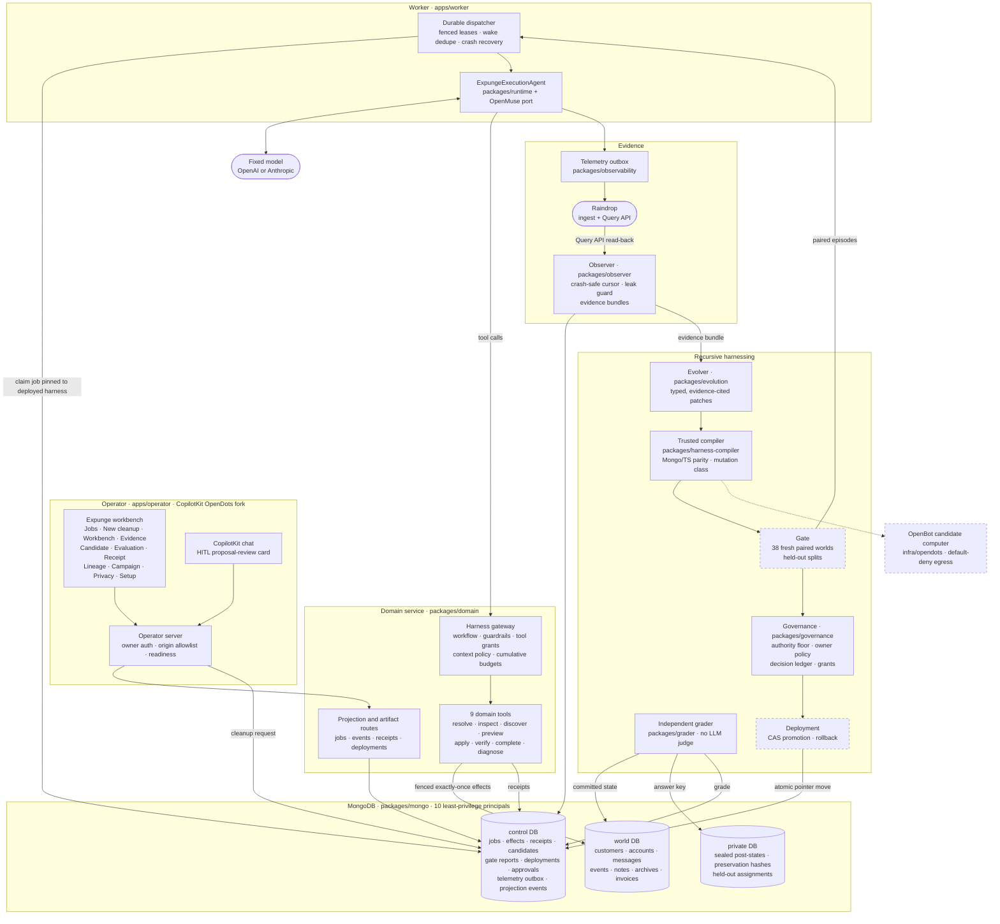
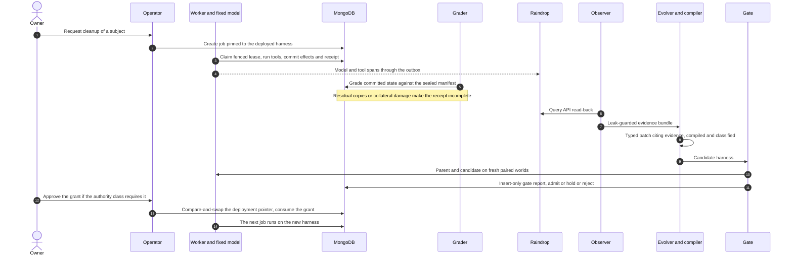

<div align="center">

# Expunge

**A database-cleanup agent that learns where records hide, rewrites its own harness, and has to prove its work to MongoDB.**<br/>
A fixed model cleans a subject out of a MongoDB dataset. An independent grader catches what it missed. Raindrop evidence feeds a typed harness change. A gate tests it on fresh paired worlds, and MongoDB promotes only a version that cleans more **without** touching data it must keep.

[](#how-it-works)
[](#mongodb-the-authority-layer)
[](#raindrop-evidence-for-the-improver)
[](#foundations-opendots-openmuse-openbot)

[](#the-harness-what-evolves)
[](packages/domain/src/tools)
[](docs/expunge/DATA-MODEL.md#principals)
[](packages/harness-compiler)
[](#project-status)
[](#project-status)
<br/>
[](tsconfig.json)
[](package.json)
[](packages/mongo/package.json)
[](apps/operator)
[](apps/operator/package.json)
[](packages/observability/package.json)
[](vitest.config.ts)
[](infra/opendots)

[How it works](#how-it-works) · [Architecture](#architecture) · [The harness](#the-harness-what-evolves) · [MongoDB](#mongodb-the-authority-layer) · [Raindrop](#raindrop-evidence-for-the-improver) · [Quick start](#quick-start) · [Status](#project-status) · [Docs](#documentation)

</div>

## Why Expunge

Deleting one person from a real company database is harder than it looks. Their records hide in nested arrays, aliases, indirect references through accounts, and reference cycles. They sit next to namesakes who must not be touched and next to records that must be retained, such as invoices. Agents asked to clean this up often report success while copies remain.

Expunge treats that failure as the training signal, under three rules:

- **Completion is checked, not claimed.** An independent grader compares the committed database state with a sealed manifest the agent can never read. It counts what was left behind and what was damaged. There is no LLM judge.
- **The harness evolves, not the model.** The model stays fixed. What changes is its harness: context policy, workflow graph, guardrails and tool access. Each change is a typed, evidence-cited patch that a trusted compiler can check.
- **MongoDB holds the authority.** A candidate harness is admitted only by fresh paired trials against its parent. It is promoted only by an atomic compare-and-swap that consumes a bound human grant when authority expands. A version that cleans more but breaks protected or unrelated data is rejected.

## How it works

| | Step | Powered by |
|---|---|---|
| **1** | **Request.** The owner asks for a subject to be cleaned. The job is created already pinned to the currently deployed harness version. |   |
| **2** | **Clean.** The worker runs the fixed model through a gateway that enforces the harness. It exposes nine domain tools: resolve subject, inspect scope, discover references, preview, apply batch, verify registered scope, complete, inspect harness and report diagnostic. Every write is a fenced, exactly-once MongoDB transaction with a receipt. |   |
| **3** | **Grade.** The independent grader reads committed state and a sealed manifest. It reports targeted residuals, retention and preservation violations, unrelated-record changes, and whether the completion claim was truthful. |  |
| **4** | **Trace.** Model and tool spans flow through a transactional outbox to Raindrop. The observer reads them back through the Query API into a leak-guarded evidence bundle. |  |
| **5** | **Propose.** The evolver writes a typed patch to one harness surface and cites the evidence IDs behind it. The trusted compiler validates it, classifies the authority change, and replays past decisions against it. | Expunge evolution + compiler |
| **6** | **Gate.** Parent and candidate run on 38 fresh paired worlds with the same model, budget and fault plan, across train, validation and protected splits. The final split is never read. Admission needs at least two extra training successes, zero retention or preservation violations, and no protected regressions. |  |
| **7** | **Promote.** An admitted candidate moves the deployment pointer in one MongoDB transaction, consuming a human grant when its authority class requires one. The next job is pinned to the new harness, and rollback is a stored receipt. |   |

## Architecture



<sub>Dashed boxes are built but not yet merged to `main`: the gate and deployment services (`packages/gate`, `packages/deployment`) and the sandboxed plugin path (`packages/plugin-sandbox`). The candidate-computer overlay in `infra/opendots` is on `main`.</sub>

### One turn of the loop



## The harness: what evolves

A harness is a typed bundle. A patch names one surface and path, and carries its `before` (re-derived from the parent), `after`, hypothesis and cited evidence IDs. It passes schema, citation, apply, compile and as-of decision replay checks before it can reach the gate.

| Surface | Patch paths | Enforced at run time by |
|---|---|---|
| **Context policy** | `contextPolicy.schemaMode`, `includeNestedArrays`, `referenceDepth`, `lessonRecall`, `maxContextTokens`, `evidenceFormat` | Domain tools: field visibility, nested-array traversal, reference depth |
| **Workflow** | `workflow`, `completionPolicy` | Gateway workflow graph: which tool may follow which, and what completion requires |
| **Guardrails** | `guardrails.<ruleId>` | Three-valued rules (allow, deny, ask) evaluated identically in TypeScript and MongoDB expressions |
| **Tool access** | `toolPolicy.grants`, `toolPolicy.prerequisites`, `limits.<limitKey>` | Session tool grants, prerequisites and structural limits such as traversal depth |
| **Plugins** | `pluginArtifacts` | Compiled sandboxed plugins: hashed today, invocation in progress |

Example patches from the test suite include widening discovery (`includeNestedArrays=true`, `referenceDepth=5`, traversal limit 5, classed *behavioral*) and adding a guardrail that denies `complete_cleanup` until verification is valid (classed *tightening*). The compiler computes each patch's mutation class, and that class decides whether promotion needs a human grant. The proposer's own claim about the class is never used.

<sub>`lessonRecall`, `maxContextTokens` and `evidenceFormat` are patchable but not yet consumed at run time.</sub>

## MongoDB: the authority layer


MongoDB is the system of record for both the data being cleaned and the authority to change the agent.

- **Three databases.** `world` holds the business records under cleanup. `control` holds jobs, intents, effects, receipts, candidates, gate reports, deployments, approvals and the telemetry outbox. `private` holds the answer key: expected post-states, preservation hashes and held-out assignments. Only its creator and the grader can read it.
- **Ten least-privilege principals:** setup, domain executor, observer, proposer, grader, approval issuer, promoter, projection reader, privacy controller and fixture builder. Each has an explicit list of what it must not be able to do; the proposer, for example, cannot read private truth or move a deployment ([data model](docs/expunge/DATA-MODEL.md#principals)).
- **Fenced, exactly-once effects.** Jobs are claimed with fenced leases. Each logical effect commits once, with its intent and receipt, inside a transaction. A zombie worker with a stale fence cannot write.
- **Atomic promotion.** Promotion compare-and-swaps the active harness pointer and consumes a bound, single-use human grant in the same transaction. Rollback is a stored receipt, and refused rollbacks are recorded too.
- **Pinned execution.** Job creation and worker claims refuse a harness that is not deployed for the scope (`HarnessNotDeployed`).
- **Change streams with recovery.** Projection streams carry per-job epochs. A corrupt resume token triggers snapshot-and-backfill instead of silent gaps.
- **Validators and RBAC.** Strict JSON-schema validators guard control and private collections, and per-principal RBAC denials are tested on local replica sets.

## Raindrop: evidence for the improver


Raindrop is how a failure becomes evidence the improver can cite.

- **Tracing.** The worker emits model and tool spans with the `raindrop-ai` SDK. Untrusted model narrative is labelled as such.
- **Transactional outbox.** Telemetry is first committed to an outbox in MongoDB, then delivered at least once with distinct delivery states, so a Raindrop outage does not lose evidence.
- **Read-back.** The observer reads events back through the Raindrop Query API with a crash-safe cursor, applies subject suppression and a leak guard, and assembles evidence bundles.
- **Cited proposals.** Every harness patch must cite evidence IDs from a bundle, and a citation check rejects patches that cite evidence outside it.

## Foundations: OpenDots, OpenMuse, OpenBot

Expunge builds on three MIT-licensed CopilotKit projects, attributed in [THIRD_PARTY.md](THIRD_PARTY.md) and [BUILT_DURING_EVENT.md](BUILT_DURING_EVENT.md).

| Foundation | Pin | Reused | Added by Expunge |
|---|---|---|---|
| [OpenDots](https://github.com/CopilotKit/OpenDots) | `625452e` | Operator shell, CopilotKit chat, computer-service wiring | The Expunge workbench (`src/client/expunge`, `src/server/expunge`), owner auth, origin rules, the HITL proposal-review card and approval dialog |
| [OpenMuse](https://github.com/CopilotKit/OpenMuse) | `1ac68f3` | `tanstackAgent` helpers (AG-UI 0.0.59, TanStack AI 0.63.0) | `packages/vendor-openmuse` port with OpenAI/Anthropic provider, metering and attempt recording, driving `ExpungeExecutionAgent` |
| [OpenBot](https://github.com/CopilotKit/OpenBot) | `b6932d3` | Computer and supervisor images | Candidate overlay with default-deny egress and DNS drop, plus a trusted broker that mints run tickets (`infra/opendots`) |

## Built to fail closed

- **Fake evidence cannot admit.** Scripted models, simulated workers and labelled fake read-backs can only ever produce `hold` with `fake_evidence`. Every simulated artifact is labelled FAKE.
- **No self-grading.** The grader has no model judge, and the agent and proposer cannot query the answer key.
- **No re-rolls.** One campaign is allowed per parent and candidate. Failed, cancelled and timed-out runs count as non-successes.
- **Approvals bind exactly.** An approval is keyed to the proposal and its digest. The button grants permission; it never claims a promotion happened.
- **Honest receipts.** An incomplete cleanup gets an incomplete receipt, and the operator shows the model's narrative as unverified.

<sub>The admission and re-roll rules live in `packages/gate`, which is not yet merged to `main`.</sub>

## Quick start

Requirements: Node `>=24.13.1 <25` or `>=25.4.0` (`.nvmrc` pins 24.13.1), npm and Docker.

```bash
npm ci
npm run typecheck
npm run lint
npx vitest run          # deterministic logic and configuration checks
```

Mongo protocol tests run against a local replica set. That proves the protocol, not Atlas:

```bash
docker compose -f packages/mongo/test/docker-compose.yml up -d
MONGODB_TEST_URI='mongodb://127.0.0.1:27018/?replicaSet=expunge-local&directConnection=true' npx vitest run packages/mongo/test
```

Operator workbench (runs setup-only until the domain and keys are configured):

```bash
npm ci --prefix apps/operator --workspaces=false
node apps/operator/scripts/run-from-root.mjs dev     # then open #/expunge
```

Configuration: copy `.env.example` to `.env` and fill values locally; per-role files keep each principal's credentials separate. Variable names are documented in [docs/ENVIRONMENT.md](docs/ENVIRONMENT.md). Never commit credentials. Every live-service suite skips without its connection string and fails under `EXPUNGE_REQUIRE_LIVE_TESTS=1`, so a skip can never pass as a success.

## Project status

Honest snapshot of the hackathon build. Per-claim evidence is in [WHAT_IS_REAL.md](WHAT_IS_REAL.md), [docs/FEATURE-MATRIX.md](docs/FEATURE-MATRIX.md) and [VERIFICATION.md](VERIFICATION.md).

| | |
|---|---|
| ✅ **Independent grader** | Sealed manifests, residual, retention, preservation and unrelated-record checks on generated company worlds (nested, array, alias, cycle and namesake structures) |
| ✅ **Harness compiler and evolution pipeline** | Typed patches, citation checks, three-valued guardrails with Mongo/TypeScript parity, a 61-code rejection catalog and as-of decision replay with score-only and wrong-incident controls |
| ✅ **MongoDB authority layer** | Three databases, ten principals, validators, fenced leases, exactly-once effects, CAS promotion with grant consumption, rollback and change-stream recovery, proven on local replica sets |
| ✅ **Operator workbench** | Eleven views plus a HITL review card, rendered and browser-tested against a labelled fixture backend |
| 🟡 **Worker and model provider** | OpenAI/Anthropic adapter, metering, retries and takeover are built; a live provider call is pending |
| 🟡 **Raindrop** | Tracing, outbox and Query API read-back are built; the first live trace is pending |
| 🟡 **Gate, deployment, Hider, meta-improver, campaign host, rehearsal, plugin sandbox** | Built and exercised with labelled fakes; not yet merged to `main`. A gate rebuild is on branch `charlie` |
| ⏳ **Model-generated harness proposals** | The structured proposer interface exists; so far, proposals come only from a labelled fake proposer or hand-written candidates |
| ⏳ **MongoDB Atlas Hackathon Sandbox** | Schema setup recorded from a teammate machine; least-privilege users and live jobs pending |
| ⏳ **First live loop** | Real failure, Raindrop trace, generated change, gate admission, promotion and a pinned next run, all with a real model |

## Repository layout

| Path | What |
|---|---|
| `apps/operator/` | OpenDots-derived operator workspace with its own npm lock. Expunge screens are in `src/client/expunge`, server routes in `src/server/expunge` |
| `apps/worker/` | Durable domain worker and dispatcher |
| `packages/contracts` | Frozen types, canonical hashing, bundle schema, native source contracts |
| `packages/mongo` | Atlas protocols: principals, validators, leases, effects, promotion, projections, provenance, privacy repositories |
| `packages/domain` | Harness gateway, nine domain tools, workflow and budget enforcement, service routes |
| `packages/fixtures`, `packages/grader` | Synthetic worlds, sealed manifests, reference solvers, independent grader |
| `packages/runtime`, `packages/vendor-openmuse` | `ExpungeExecutionAgent` and the attributed OpenMuse helper port |
| `packages/governance` | Owner authority floor, owner policy, policy evaluator, decision ledger, live floor fence |
| `packages/harness-compiler`, `packages/evolution` | Trusted compiler of typed harness bundles; evidence-cited proposals, critic and decision replay |
| `packages/observability`, `packages/observer` | Raindrop tracing with a transactional outbox; observer read-back, cursor and evidence bundles |
| `packages/baselines` | W0 and expert-static harness bundles and the disclosed primitive vocabulary |
| `packages/privacy` | Erasure store, per-job suppression and bounded content purge |
| `infra/opendots` | Computer host topology and the egress-restricted candidate overlay |
| `docs/` | Contracts, data model, acceptance protocol, reviews, UI manifests and continuity state |

## Documentation

| | |
|---|---|
| [Contracts](docs/expunge/CONTRACTS.md) · [Data model](docs/expunge/DATA-MODEL.md) · [Acceptance](docs/expunge/ACCEPTANCE.md) | Authoritative design, MongoDB model and the acceptance protocol |
| [WHAT_IS_REAL.md](WHAT_IS_REAL.md) · [Feature matrix](docs/FEATURE-MATRIX.md) · [VERIFICATION.md](VERIFICATION.md) | Every claim mapped to code and recorded evidence |
| [COMMIT-LEDGER.md](COMMIT-LEDGER.md) · [Reviews](docs/review/) | Per-commit verification receipts and devil's-advocate findings with reproduction scripts |
| [BUILT_DURING_EVENT.md](BUILT_DURING_EVENT.md) · [THIRD_PARTY.md](THIRD_PARTY.md) | What was prepared, imported and built during the event |
| [Preregistration](PREREGISTRATION.md) | The evaluation protocol (draft, to be frozen before any results) |

## Team

[@nihalnihalani](https://github.com/nihalnihalani) and [@charliegillet](https://github.com/charliegillet). The build was run by AI agent teams with named roles: a lead and devil's advocate on Claude Opus 5.5, builders and two independent verifiers on Claude Sonnet 5.5, and a Claude Haiku 5.5 commit steward as the only Git writer. A later Codex session (GPT-6 family) worked on the real-data migration. Every commit is a reviewed packet recorded in [COMMIT-LEDGER.md](COMMIT-LEDGER.md). Work happens on `main` and `charlie`; `charlie` merges into `main` by pull request.

## License

OpenDots, OpenBot and OpenMuse components keep their MIT licenses; see [THIRD_PARTY.md](THIRD_PARTY.md). A license for Expunge's own code has not been chosen yet.

<sub>Expunge does not claim automatic legal compliance, model-weight improvement or exactly-once delivery to external vendors. Delete, redact, restrict and tombstone are product effects under owner policy.</sub>
