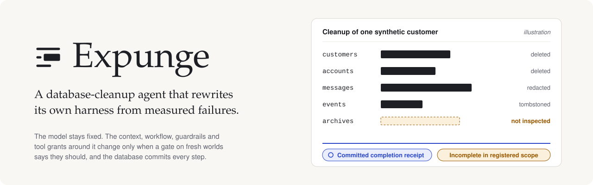
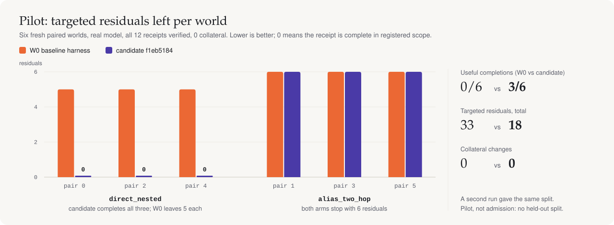
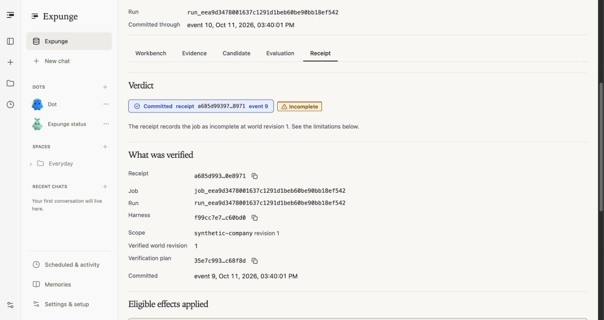
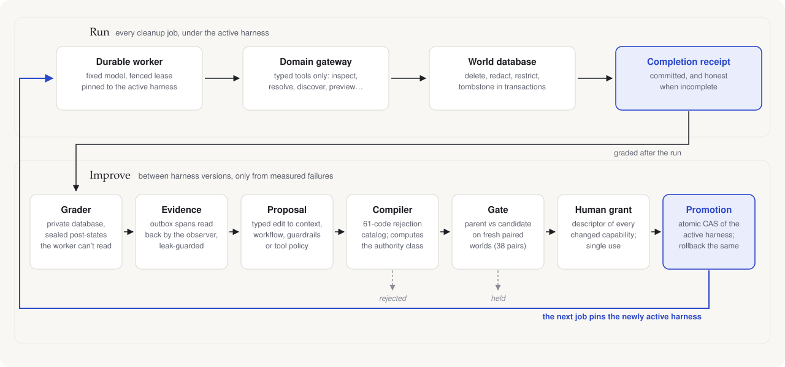
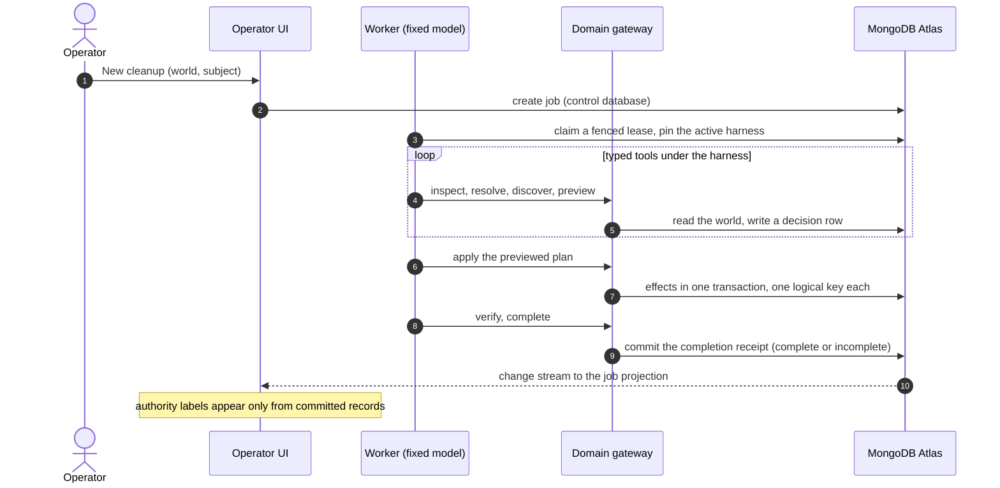
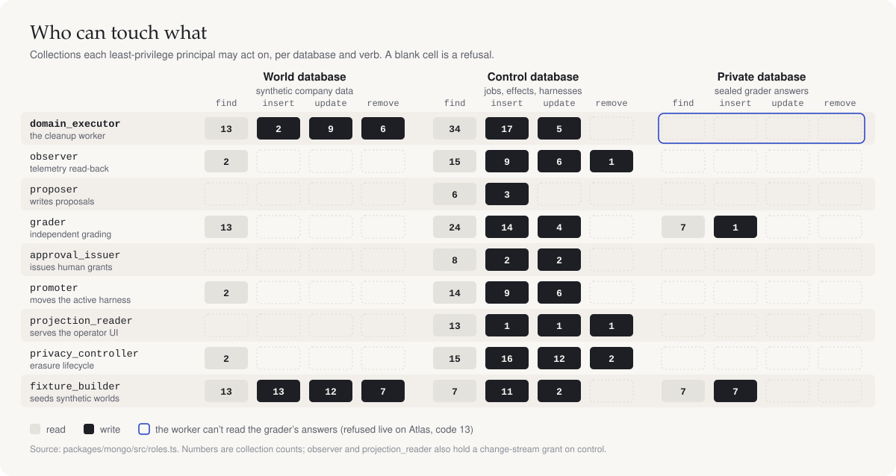
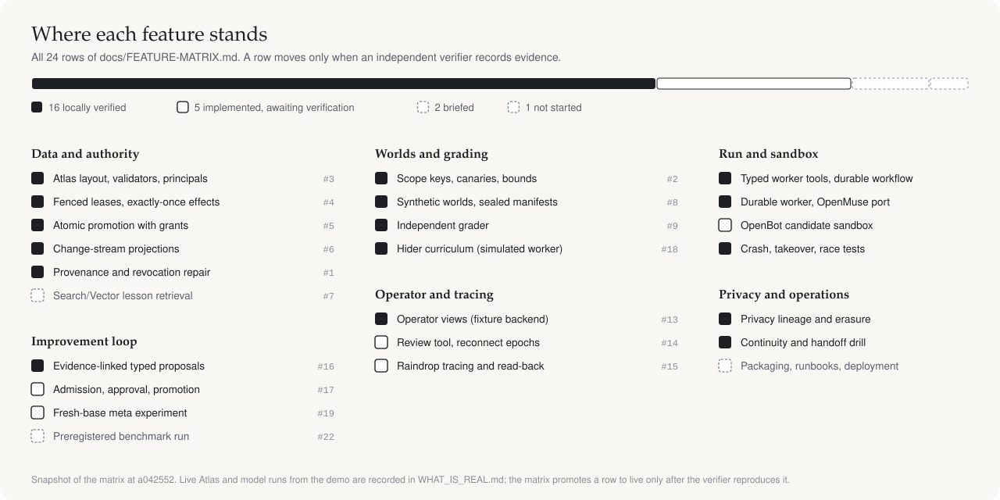

<div align="center">

<picture>
  <source media="(prefers-color-scheme: dark)" srcset="assets/readme/hero-dark.svg"/>
  
</picture>

[](#guarantees-the-database-enforces)
[](#how-it-works)
[](#credits)

[](VERIFICATION.md)
[](apps/operator/tests)
[](docs/MONGO.md)
[](docs/demo/pilot.md)
[](#project-status)

**[Results](#results-so-far)** · **[How it works](#how-it-works)** · **[Guarantees](#guarantees-the-database-enforces)** · **[Get started](#get-started)** · **[Status](#project-status)** · **[Docs](#documentation)**

</div>

Deleting one person from a company database is a graph problem. The customer row is easy to find. The references nested in messages, notes, events and archives are not, and a model told to "delete everything about this customer" will report success after removing the first record.

Expunge keeps the model **fixed** and improves the **harness** around it: the context it sees, the workflow it follows, the guardrails that refuse unsafe steps, and the tools it may call. A harness changes only after an independent grader measures a failure, a trusted compiler accepts the edit, and a fixed gate tests it on fresh worlds. MongoDB Atlas commits every step, and promotion needs a human grant.

> [!NOTE]
> Every world here is synthetic company data. Expunge supports delete, redact, restrict and tombstone under owner policy. It does not claim automatic legal compliance, model-weight improvement or unbounded recursive acceleration.

Statement One (Recursive Harnessing), Harness Engineering and Model Wrangling hackathon, 11 October 2026.

## Results so far

The demo ran a fixed real model (`openai/gpt-6-luna`) under two harnesses: the baseline W0 and a candidate child, `f1eb5184`. The candidate changes three settings in the context and limits surfaces: show all registered fields (`schemaMode: all_registered_fields`), include nested arrays, and follow references up to five hops instead of one.

<picture>
  <source media="(prefers-color-scheme: dark)" srcset="assets/readme/pilot-dark.svg"/>
  
</picture>

| Run | W0 baseline | Candidate `f1eb5184` | Label |
|---|---|---|---|
| Pilot: 6 fresh paired worlds ([pilot.md](docs/demo/pilot.md)) | 0/6 useful, 33 residuals | **3/6 useful, 18 residuals** | Pilot, not admission |
| Promotion run: one job each after an atomic promotion ([promotion.md](docs/demo/promotion.md)) | 5 residuals, receipt `incomplete` | **0 residuals, `complete_in_registered_scope`** | Test-fixture admit; one run per arm |
| Baseline on the invited Atlas Sandbox ([DEMO.md](docs/demo/DEMO.md)) | committed receipt `a685d993…`, incomplete | | Real Atlas, real model |

> [!IMPORTANT]
> The gain is on the `direct_nested` family only; both arms fail every `alias_two_hop` world. Six pairs, no held-out split and no statistics make this a pilot. A real admission needs 38 paired trials, and the candidate was written by an operator, because the evolver has no real model adapter yet. All 12 pilot receipts were verified, with 0 collateral changes in either arm, and a second run gave the same split.

<p align="center">
  
  <br/><sub>The operator's Receipt tab for the Atlas baseline run. The database committed the receipt, and it says <b>Incomplete</b>: W0 found the customer record but missed the nested references.</sub>
</p>

## How it works

<picture>
  <source media="(prefers-color-scheme: dark)" srcset="assets/readme/loop-dark.svg"/>
  
</picture>

A proposal is a typed edit to one of four surfaces. The compiler checks it against a 61-code rejection catalog and computes its authority class; anything that widens what the worker may do needs a human grant.

| Surface | What it controls | Example in the demo candidate |
|---|---|---|
| **Context** | what the model sees about each record | `schemaMode` from `selected_fields` to `all_registered_fields`; nested arrays on |
| **Workflow** | the phase graph: inspect, resolve, discover, preview, apply, verify, complete | unchanged |
| **Guardrails** | three-valued rules that refuse unsafe steps before they run | unchanged |
| **Tool policy and limits** | which typed tools are granted, and budgets such as traversal depth | `traversalDepth` from 1 to 5 |

<details>
<summary><b>One cleanup job, step by step</b></summary>



A crashed worker's late write is refused by the lease fence, and a retry can't apply an effect twice. The grader then compares the world against sealed expected post-states in a database the worker's principal can't read.

</details>

## Guarantees the database enforces

<picture>
  <source media="(prefers-color-scheme: dark)" srcset="assets/readme/access-dark.svg"/>
  
</picture>

- **Least privilege, probed live.** A read-only probe connected to Atlas as each of the nine principals and tried find, insert, update and remove on 79 collections. All **2,844 outcomes matched the committed role manifests**, with 0 surprises and 0 writes ([MONGO.md](docs/MONGO.md)).
- **Fail-closed attestation.** If a run's model stamp can't be written, the run stops before any model call (`ModelAttestationFailed`). The gate reads stamps only from the insert-only `run_attestations` collection.
- **Atomic promotion.** One transaction consumes a single-use grant and compare-and-swaps the active harness, and a same-parent race has exactly one winner. Rollback is the same operation with its own grant.
- **Evidence the improver can cite.** Spans are written to a transactional outbox and read back by an observer into leak-guarded evidence bundles. The baseline episode reached Raindrop and was read back through the Query API (trace `7002add2…`, 20 spans).

Four facts are never merged into one badge, in the UI or here:

| Fact | Where it comes from |
|---|---|
| Model narrative | the model's own text, drawn as "not verified" |
| Operational completion | the committed receipt, in registered scope, as of a world revision |
| Hidden-grader correctness | the independent grader (evaluation views only) |
| External erasure | the provider's status: not required, pending, confirmed or failed |

## Get started

**Prerequisites:** Node `>=24.13.1 <25.0.0 || >=25.4.0` (`.nvmrc` pins 24.13.1) and Docker for the local replica sets.

```bash
npm ci
npm run typecheck
npx vitest run
```

Every live suite skips without its connection string and **fails** under `EXPUNGE_REQUIRE_LIVE_TESTS=1`, so a skip can never pass as a success. To run the Mongo protocol tests against a local replica set (protocol proof, not Atlas proof):

```bash
docker compose -f packages/mongo/test/docker-compose.yml up -d
MONGODB_TEST_URI='mongodb://127.0.0.1:27018/?replicaSet=expunge-local&directConnection=true' npx vitest run packages/mongo/test
```

To start the operator UI:

```bash
npm ci --prefix apps/operator --workspaces=false
npm run dev
```

> [!TIP]
> With a filled-in `.env` (copy `.env.example`; names are documented in [`docs/ENVIRONMENT.md`](docs/ENVIRONMENT.md)), `npm run domain` starts the domain service and `npm run seed:world` seeds a synthetic world. Set `OWNER_TOKEN` to require an owner token in the UI.

> [!WARNING]
> Node 24 builds before 24.13.1, and 25 builds before 25.4.0, throw inside `util.inspect` when a ZodError is logged (nodejs/node#60717).

## Project status

<picture>
  <source media="(prefers-color-scheme: dark)" srcset="assets/readme/evidence-dark.svg"/>
  
</picture>

| | |
|---|---|
| ✅ **Real on Atlas** | Baseline cleanup with a real model, least-privilege roles, fail-closed attestation, one Raindrop episode ingested and read back |
| ✅ **Real mechanics** | Harness compiler on a real candidate; descriptor, grant, atomic promotion, pinned runs and rollback |
| ⚪ **Pilot only** | Candidate 3/6 vs W0 0/6 on fresh worlds, not an admission |
| ⏳ **Not yet run** | A real gate admission (38 paired trials); an evolver-generated candidate; submit-time Raindrop subject registration |
| ⛔ **Blocked** | Atlas Search/Vector lesson retrieval, authorized owner data, the 360-episode protocol. Hider and the meta-improver are verified only on a simulated worker |

[`WHAT_IS_REAL.md`](WHAT_IS_REAL.md) maps each claim to its code and evidence, and [`docs/FEATURE-MATRIX.md`](docs/FEATURE-MATRIX.md) holds per-feature state.

## Tech stack

| Layer | Technology |
|---|---|
| Language | TypeScript (strict), Node.js 24.13.1 |
| Database | MongoDB Atlas, `mongodb` driver 7.7.0: transactions, custom roles, change streams |
| Worker | durable worker and dispatcher with OpenMuse `tanstackAgent` helpers; TanStack AI 0.63, AG-UI 0.0.59 |
| Tracing | Raindrop (`raindrop-ai` 1.0.1), OpenTelemetry API 1.9.1 |
| Operator UI | React 19, Hono 4, Zod 4, CopilotKit 1.75 on the OpenDots shell |
| Sandbox | OpenBot computer images with a default-deny egress overlay |
| Tests | Vitest 4, local replica sets via Docker Compose |

## Project structure

<details>
<summary><b>Repository layout</b></summary>

```text
apps/
  operator/            operator UI and API (own npm lock); Expunge views in src/client/expunge
  worker/              durable worker and dispatcher
packages/
  contracts/           frozen types, canonical hashing, bundle schema
  mongo/               Atlas protocols: roles, validators, leases, effects, projections
  domain/              domain gateway and typed tools
  governance/          owner authority floor, policy evaluator, decision ledger
  fixtures/ grader/    synthetic worlds, sealed manifests, independent grader
  baselines/           W0 and expert-static harness bundles
  harness-compiler/    typed bundles, three-valued guardrails, rejection catalog
  evolution/ gate/     evidence-cited proposals, as-of replay, fresh paired admission
  deployment/          approval descriptors, grants, promotion, rollback
  runtime/ vendor-openmuse/   execution agent and the attributed OpenMuse port
  observability/ observer/    tracing, outbox, read-back, evidence bundles
  privacy/             retraction closure, artifact purge, external erasure
infra/                 candidate sandbox overlay and service images
docs/                  contracts, demo, runbooks, reviews, UI audit
```

</details>

## Testing

| Check | Result |
|---|---|
| `npx vitest run`, default lane on a clean export of `2ea3d3b` | **1,095 passed**, 0 failed, 591 skipped (live suites without services) |
| `apps/operator` suite | **586 passed** across 77 files |
| Reliability live lane: crash, takeover, netguard, candidate proxy, resume token | **150 / 150** |
| Admission gate, live lane | **222 / 222** |
| typecheck (strict), eslint, prettier | clean |

Receipts with commands and checkpoints are in [`VERIFICATION.md`](VERIFICATION.md).

## How the build is run

A lead coordinates named role agents: Mongo authority, runtime and Raindrop, RSI evolution, UI/UX, independent verifiers, a devil's advocate, and a commit steward that is the only Git writer for team packets. An owner freezes each packet's paths; a verifier runs the checks on a hash-pinned checkpoint; the steward stages exactly those paths and records the commit in [`COMMIT-LEDGER.md`](COMMIT-LEDGER.md). See [`docs/continuity/OWNERSHIP.md`](docs/continuity/OWNERSHIP.md).

## Documentation

| Read this | For |
|---|---|
| [Demo walkthrough](docs/demo/DEMO.md) | the governed loop, each step labelled real, pilot or test fixture |
| [What is real](WHAT_IS_REAL.md) · [Feature matrix](docs/FEATURE-MATRIX.md) · [Verification](VERIFICATION.md) | claims with evidence, per-feature state, check receipts |
| [Contracts](docs/expunge/) · [Mongo](docs/MONGO.md) · [Environment](docs/ENVIRONMENT.md) | design contracts, database layout, settings by name |
| [Design system](DESIGN.md) · [UI audit](docs/ui/) | the operator's visual language and component states |
| [Runbooks](docs/runbooks/) | deploy, backup and restore, secret rotation, upgrade and rollback, incidents |
| [Reviews](docs/review/) | devil's-advocate findings with reproduction scripts |

## Credits

Built by [@nihalnihalani](https://github.com/nihalnihalani) and [@charliegillet](https://github.com/charliegillet). The operator shell, candidate sandbox and worker helpers build on CopilotKit's MIT-licensed [OpenDots](https://github.com/CopilotKit/OpenDots), OpenBot and OpenMuse, pinned and attributed in [`THIRD_PARTY.md`](THIRD_PARTY.md). [`BUILT_DURING_EVENT.md`](BUILT_DURING_EVENT.md) separates what was prepared, imported and built.
