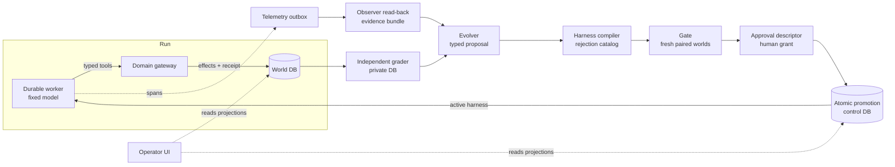
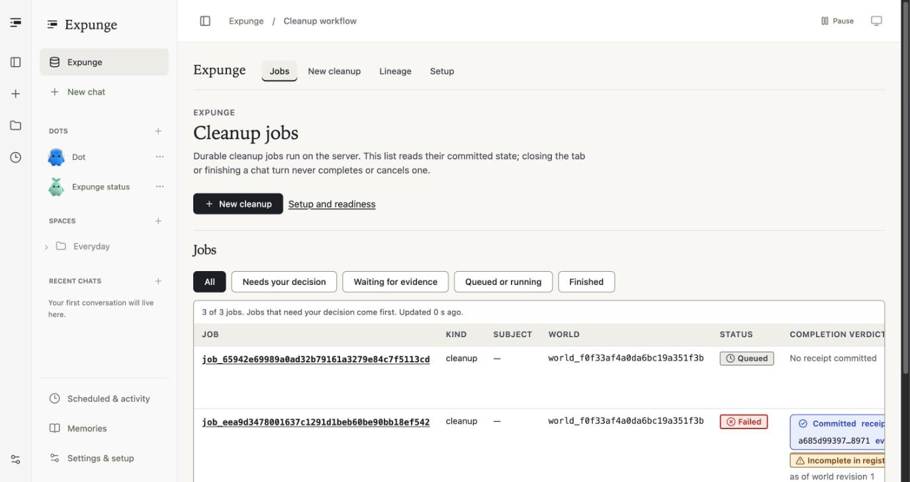

<div align="center">

# Expunge

**A governed database-cleanup agent that rewrites its own harness from measured failures.**<br/>
A fixed model removes a customer from a MongoDB company dataset. An independent grader finds what it missed. A typed proposal changes the harness, a fixed gate tests it on fresh worlds, and Atlas promotes the version that passes.

[](#mongodb-atlas-the-system-of-record)
[](#raindrop-evidence-for-the-improver)
[](#copilotkit-foundations)

[](VERIFICATION.md)
[](apps/operator/tests)
[](WHAT_IS_REAL.md)
[](#project-status)
[](#project-status)
<br/>
[](tsconfig.json)
[](.nvmrc)
[](packages/mongo/package.json)
[](apps/operator/src/client)
[](apps/operator/src/server)

[How it works](#how-it-works) · [Atlas](#mongodb-atlas-the-system-of-record) · [Raindrop](#raindrop-evidence-for-the-improver) · [CopilotKit](#copilotkit-foundations) · [Quick start](#quick-start) · [Status](#project-status) · [Docs](#documentation)

</div>

<p align="center">
  
  <br/><sub>The Receipt tab for the demo's baseline run against the MongoDB Atlas Sandbox, with a real model and a synthetic world. The database committed the receipt; it says <b>Incomplete</b> because the baseline harness missed nested references.</sub>
</p>

Statement One (Recursive Harnessing) of the Harness Engineering and Model Wrangling hackathon, 11 October 2026.

## Why Expunge

Deleting one person's data from a real company database is a graph problem. The customer row is easy to find. The references nested in tickets, messages, events and archives are not. A model told to "delete everything about this customer" will happily report success after removing only the first record.

You can't fix that by trusting the model's narrative or by retraining it. Expunge keeps the model fixed and improves the **harness** around it instead: the context it sees, the workflow graph it follows, the guardrails that refuse unsafe steps, and the tools it is allowed to call. Every change is:

- **Caused by a measured failure.** An independent grader, holding expected post-states the worker never sees, says exactly what was missed.
- **Typed and compiled.** A proposal is a typed edit to one of the four surfaces, and a trusted compiler rejects unsafe edits before anything runs.
- **Tested on fresh worlds.** A fixed gate runs parent and candidate on new paired synthetic worlds. Scoring well on old failures doesn't count.
- **Promoted by the database, with a human in the loop.** Atlas moves the active harness pointer atomically, consuming a single-use human grant when the change widens authority. Rollback is the same operation in reverse.

## How it works

| | Step | Powered by |
|---|---|---|
| **1** | **Run a cleanup.** The durable worker claims a job through a fenced lease and drives a fixed model through typed tools: inspect, resolve, discover, preview, apply, verify, complete. Every tool call goes through the domain gateway, never straight to the database. |  |
| **2** | **Write effects once.** Delete, redact, restrict and tombstone run as logical effects inside MongoDB transactions, keyed so a retry or a takeover can never apply one twice. The run ends with a committed completion receipt, including an honest *incomplete* one. |  |
| **3** | **Grade independently.** A grader in a private database compares the world against sealed expected post-states and preservation hashes, built without the reference solver. The worker's principal can't read it. |  |
| **4** | **Trace and collect evidence.** Model and tool spans go through a transactional telemetry outbox; an observer reads them back into leak-guarded evidence bundles. |  |
| **5** | **Propose and compile.** The evolver cites evidence and proposes a typed edit to context, workflow, guardrails or tool policy. The harness compiler checks it against a 61-code rejection catalog and computes its authority class. | Expunge core |
| **6** | **Gate on fresh worlds.** Parent and candidate run on new paired synthetic worlds, with score-only and wrong-incident controls. The admission rule needs 38 paired trials. |  |
| **7** | **Approve and promote.** The operator reviews a descriptor rendered from stored rows: every capability that changes, and its consequences. Approval issues a single-use grant; promotion consumes it and CAS-moves the active harness. |   |
| **8** | **Run again.** The next job pins to the newly active harness. A rule the child added now refuses a step the parent would have allowed. | Expunge core |



<p align="center">
  
  <br/><sub>Jobs list. Status and completion verdict are separate facts: a job can fail while its receipt is committed and says exactly what is incomplete.</sub>
</p>

## MongoDB Atlas: the system of record


Every authority decision in Expunge is a database write, not an application flag.

- **Three databases, nine principals.** World, control and private databases, each reached only by the principals that need it. A read-only probe connected as each of the nine principals and tried find, insert, update and remove on 79 collections: **2,844 outcomes matched the committed role manifests, 0 surprises, 0 writes**. The worker's read of the private grader database was refused (code 13). Source: [`packages/mongo/src/roles.ts`](packages/mongo/src/roles.ts) and the read-only probe in `scripts/atlas-rbac-probe.ts`.
- **Fenced leases and exactly-once effects.** Jobs are claimed with fenced leases; effects carry logical keys and commit in transactions, so a crashed worker's late write is refused ([`packages/mongo/src/jobs.ts`](packages/mongo/src/jobs.ts), [`effects.ts`](packages/mongo/src/effects.ts)).
- **Fail-closed attestation.** A run whose model stamp can't be written stops before any model call (`ModelAttestationFailed`). The gate reads stamps only from the insert-only `run_attestations` collection, so a fake model or a missing stamp holds a candidate rather than admitting it.
- **Atomic promotion with a grant.** Promotion consumes a bound human grant and CAS-moves the active harness in one transaction; a same-parent race has exactly one winner ([`packages/deployment/`](packages/deployment/)).
- **Change-stream projections.** The operator UI reads per-job projections built from change streams with resume tokens and contiguous sequences, so a reload never re-runs anything.

## Raindrop: evidence for the improver


The improver may only cite evidence that was actually recorded and read back.

- **Transactional outbox.** Spans are written to an outbox in the same transaction as the work they describe, with distinct delivery states. Delivery is at-least-once with reconciliation ([`packages/observability/`](packages/observability/)).
- **Observer read-back.** A crash-safe observer reads traces back and packs them into evidence bundles with a leak guard, so hidden grader answers can't reach a proposal ([`packages/observer/`](packages/observer/)).
- **Honest status.** The protocol is tested against a fake ingest endpoint and a local replica set. The live Raindrop suite has never run: it needs write and query keys, and under `EXPUNGE_REQUIRE_LIVE_TESTS=1` it fails by name instead of skipping.

## CopilotKit foundations


Expunge builds on three MIT-licensed CopilotKit projects, pinned and attributed in [`THIRD_PARTY.md`](THIRD_PARTY.md):

- **OpenDots** is the operator shell ([`apps/operator/`](apps/operator/)). Expunge adds readiness, new cleanup, the workbench with its reference graph, the receipt, candidate review, approval, evaluation, lineage and privacy views under `src/client/expunge` and `src/server/expunge`.
- **OpenBot** computer images host the candidate sandbox: default-deny egress, DNS dropped on all interfaces, and a trusted broker with run tickets ([`infra/opendots/`](infra/opendots/)).
- **OpenMuse** `tanstackAgent` helpers are ported into [`packages/vendor-openmuse/`](packages/vendor-openmuse/) for the worker's model loop.

## Built for people who need proof

- **Committed is not claimed.** The UI shows an authority label only when a committed record backs it. Model narrative sits in a visibly different block marked "not verified".
- **Distinct verdicts stay distinct.** Model narrative, operational completion in the registered scope, hidden-grader correctness and external erasure are four separate facts, never merged into one badge.
- **Coverage is explicit.** "Complete" always says "in registered scope, as of revision N" and lists the registered collections that weren't inspected.
- **Nothing pretends to pass.** Every live-service suite skips without its connection string and fails under `EXPUNGE_REQUIRE_LIVE_TESTS=1`, so a skip can never pass as a success.

## Quick start

Local, no credentials:

```bash
npm ci
npm run typecheck
npm run lint
npx vitest run
```

Mongo protocol tests against a local replica set (protocol proof, not Atlas proof):

```bash
docker compose -f packages/mongo/test/docker-compose.yml up -d
MONGODB_TEST_URI='mongodb://127.0.0.1:27018/?replicaSet=expunge-local&directConnection=true' npx vitest run packages/mongo/test
```

Operator UI (setup-only without keys; set `OWNER_TOKEN` in the root `.env` to require an owner token):

```bash
npm ci --prefix apps/operator --workspaces=false
npm run dev
```

With a configured `.env`, `npm run domain` starts the domain service and `npm run seed:world` seeds a synthetic world. The authenticated RBAC lane uses `packages/mongo/test/auth-docker-compose.yml`; see [`docs/MONGO.md`](docs/MONGO.md).

Node `>=24.13.1 <25.0.0 || >=25.4.0` (`.nvmrc` pins 24.13.1). Earlier 24.x and 25.x builds throw inside `util.inspect` when a ZodError is logged (nodejs/node#60717).

## Quality

| Check | Result |
|---|---|
| `npx vitest run`, default lane on a clean export of `2ea3d3b` | **1,095 passed**, 0 failed, 591 skipped (live suites without services) |
| `apps/operator` test suite | **586 passed** (77 files) |
| Reliability live lane: crash, takeover, netguard, candidate proxy, resume token | **150 / 150** |
| Admission gate, live lane | **222 / 222** |
| Atlas RBAC probe, nine principals × 79 collections | **2,844 outcomes**, 0 surprises, 0 writes |
| typecheck (strict) · eslint · prettier | clean |

Receipts, commands and checkpoints are in [`VERIFICATION.md`](VERIFICATION.md); per-feature state is in [`docs/FEATURE-MATRIX.md`](docs/FEATURE-MATRIX.md).

## Project status

| | |
|---|---|
| ✅ **Real run on Atlas** | Baseline W0 cleanup against the invited Atlas Sandbox with a real model, on a synthetic seeded world: 5 model calls, committed receipt `a685d993…` marked incomplete. [What is real](WHAT_IS_REAL.md) |
| ✅ **Governance enforced** | Atlas least-privilege roles (probe above) and fail-closed model attestation, both on Atlas |
| ✅ **Compiler and promotion mechanics** | A candidate compiled by the real harness compiler (authority class computed); approval descriptor, single-use grant, atomic promotion, pinned run and rollback. The admit report used for promotion is a labelled test fixture. |
| ⚪ **Pilot, not admission** | Baseline vs candidate on fresh worlds with the real model: 12 episodes, all receipts verified, 0 collateral, **0/6 useful in both arms**. A null result. |
| ⏳ **Real admission** | Needs 38 paired trials with the real worker; not run yet. The evolver has no real model adapter, so the demo candidate is operator-authored |
| ⛔ **Blocked** | Raindrop ingest and read-back (keys), Atlas Search/Vector lesson retrieval (not started), authorized owner data and the 360-episode protocol. Hider and the meta-improver are verified only on a simulated worker |

What [`WHAT_IS_REAL.md`](WHAT_IS_REAL.md) explicitly does **not** claim: automatic legal compliance, model-weight improvement or unbounded recursive acceleration, exactly-once delivery to external vendors, or document-level row security from Atlas roles.

## Documentation

| | |
|---|---|
| [Feature matrix](docs/FEATURE-MATRIX.md) · [What is real](WHAT_IS_REAL.md) · [Verification](VERIFICATION.md) | Per-feature state, claims with evidence, check receipts |
| [Contracts and data model](docs/expunge/) · [Mongo](docs/MONGO.md) · [Environment](docs/ENVIRONMENT.md) | Design contracts, database layout, settings by name |
| [Design system](DESIGN.md) · [UI audit and states](docs/ui/) | Operator UI direction ("the ledger") and component states |
| [Runbooks](docs/runbooks/) | Deploy, backup and restore, secret rotation, upgrade and rollback, incident |
| [Reviews](docs/review/) | Devil's-advocate findings with reproduction scripts (each exits 1 once the defect is fixed) |
| [Built during the event](BUILT_DURING_EVENT.md) · [Third-party](THIRD_PARTY.md) | What was prepared, imported and built |

**Repository layout:** `apps/operator` (operator UI and API, own npm lock) · `apps/worker` (durable worker and dispatcher) · `packages/{contracts,mongo,domain,governance}` (types, Atlas protocols, gateway, authority) · `packages/{fixtures,grader,baselines}` (synthetic worlds, independent grader, W0 and expert bundles) · `packages/{harness-compiler,evolution,gate,deployment}` (the improvement loop) · `packages/{runtime,vendor-openmuse,observability,observer,privacy}` (execution, tracing, evidence, erasure) · `infra/` · `docs/`.

## Team

Team: [@nihalnihalani](https://github.com/nihalnihalani) and [@charliegillet](https://github.com/charliegillet). Built by a lead with named role agents: Mongo authority, runtime and Raindrop, RSI evolution, UI/UX, independent verifiers, a devil's advocate, and a commit steward that is the only Git writer for the team's packets. Every packet is frozen by its owner, verified on a hash-pinned checkpoint, staged path by path and recorded in [`COMMIT-LEDGER.md`](COMMIT-LEDGER.md). See [`docs/continuity/OWNERSHIP.md`](docs/continuity/OWNERSHIP.md).

Copy `.env.example` to `.env` at the repository root and fill the values locally. Credentials are never committed or printed.

## License

There is no license file at the repository root yet. Imported foundations keep their own licenses: OpenDots, OpenBot and OpenMuse are MIT-licensed CopilotKit projects (see [`THIRD_PARTY.md`](THIRD_PARTY.md) and [`apps/operator/LICENSE`](apps/operator/LICENSE)).
