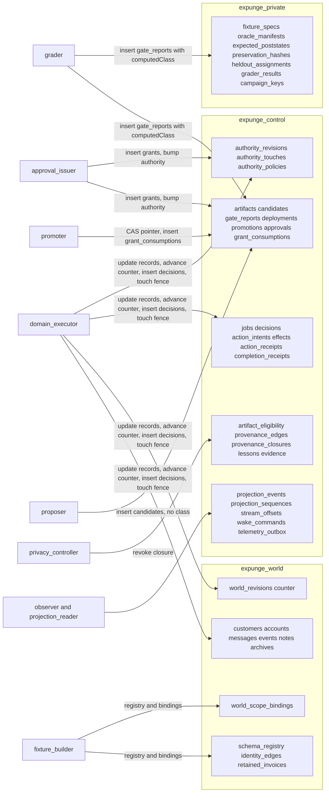

# MongoDB foundation (packages/mongo)

MongoDB is the authority for consequential domain and control state. This file says what the code touches, who may do
what, and how to run the protocol tests. **Every test result below comes from a local replica set. It proves protocol
behavior (transactions, fences, validators, unique indexes). It is not evidence about the invited Atlas deployment, Atlas
RBAC, or Search/Vector, and none of those has been exercised: there is no root `.env`, so all live Atlas checks are BLOCKED.**

## Principals (separate MongoClient and URI each; no fallback to setup)
| Principal | Does | Cannot (structurally) |
|---|---|---|
| setup | DDL, validators, indexes, seeds authority and policy, test administration | run in any model-accessible container |
| domain_executor | update domain records and the world counter, insert decisions, touch `authority_touches`, run cleanup jobs | write registry, bindings, `authority_revisions`, retained data, gate reports, grants |
| fixture_builder | create worlds, registry, bindings; private manifests | grants, authority, decisions |
| proposer | insert artifacts and candidate proposals | update anything, write a class, read private truth |
| grader | read private truth, insert gate reports (the only source of `computedClass`) | update a report, approvals, authority |
| approval_issuer | insert grants after checking them against the stored report; bump the authorization revision | edit or delete a grant, write reports |
| promoter | move deployment pointers, insert `grant_consumptions`, update candidate state | update `approvals`, `authority_revisions`, policy |
| privacy_controller / observer / projection_reader | revocation and retraction / evidence and outbox / read events | destructive domain tools, promotion |

Atlas privileges are additive and collection-level. `atlasRoleManifests()` is the body to apply through the Atlas
Administration API; driver `createRole` is used only by the local RBAC test.

## Protocol rules worth knowing
- **Approval is derived.** `promote` takes the class from the grader-written gate report and the requirement from the
  `authority_policies` row. `authority_expansion` always needs a grant, `tightening` never, `behavioral` per policy. The
  candidates row is a proposer's note and is never read for authorization. A grant must equal the binding derived from the
  stored report (hashes, flip-set digest, descriptor) at issue and at spend, and is spent by inserting a unique row.
- **Live authorization.** Effects, `complete`, `promote` and `rollback` read `authority_revisions` and conditionally write
  `authority_touches` under the expected revision; a bump rewrites both rows in one transaction, so a stale snapshot aborts.
  A stale run fails with `AuthorityRevisionStale`. An effect also needs a matching row in the `decisions` ledger
  (`decisionId`), and its `effectKey`, `argsDigest` and `targetHash` are derived by the repository, not supplied.
- **World = counter + binding.** The worker advances `world_revisions`; only setup and the fixture builder write
  `world_scope_bindings`, and rebinding also advances the counter so an in-flight effect conflicts.
  `JobRepository.create` requires an existing world under the actor's scope, at its scope revision, outside maintenance.
- **Scope paths.** Registered paths live under `data.*` (plus the read-only record key `_id`). `*` compiles to a filtered
  positional update or element `$pull`, never to a whole-array write.
- **Effects are bound to the versions the plan saw.** `commitEffect` requires `expectedDocumentVersions` to name exactly
  the intent's targets (once each, non-negative integer versions; otherwise `VersionBindingMismatch`), re-reads every
  target's `_rev` inside the transaction before `apply` runs (`StaleDocumentVersion`), and refuses an `apply` that returns
  fewer effects than targets (`PartialEffect`). A refused batch writes nothing: no effect row, receipt or counter move.
  The derived `argsDigest` binds those versions, so replaying an effect key at other versions is an
  `IdempotencyConflict`, never the saved receipt. Malformed version lists are reported as `VersionBindingMismatch`
  before the digest is compared.
- **No world write outside an effect.** `ScopeRepository.writeField` takes the effect transaction's session and throws
  `EffectTransactionRequired` without one; `applyEffect` is the single-update path the gateway uses.
- **A world key comes from a stored row.** `JobRepository.worldKey(actor, jobId)` reads the job and mints the `WorldKey`;
  `WorldRepository.bind` mints one from the stored world binding. `worldKeyOf` is package-internal and not exported from the
  index, so no caller can brand a job-shaped object of its own.
- **Receipt refusals have their own codes.** A wrong verdict is `IncompleteReceipt` (complete) or `ReceiptNotIncomplete`
  (incomplete); a receipt that does not cover the registry is `ReceiptCoverageIncomplete`.
- **Decision rows come back as stored.** Recording the same decision again returns the stored row (with its first inputs and
  digest), never the caller's object. The ledger is insert-only by privilege; it is not hash-chained (see the G6 note in the
  review) and makes no tamper-evidence claim.
- **Approval-gated workflows cannot proceed yet.** The gateway resolves the `approval_grant` binding to "absent", so a
  bundle prerequisite on it always denies (fails closed) until grants are wired to the decision path.
- **Incomplete receipts.** `EffectRepository.complete` commits only a `complete_in_registered_scope` receipt with zero
  residuals and finishes the job `succeeded`. `completeIncomplete` commits an `incomplete` receipt (at least one residual)
  under the same job binding, registry coverage, authority fence and world checks, and finishes the job `failed` with that
  receipt as its output, so a run that claims success without having cleaned the data leaves a truthful committed record.
  Neither method accepts the other's verdict.
- **Campaign keys.** `expunge_private.campaign_keys` holds one 32-byte key per campaign for the fixture builder and grader
  (strict validator, insert-only; fixture builder inserts, fixture builder and grader read, nobody updates or removes).
- **Provenance.** Revocation is a bounded, resumable closure persisted in `provenance_closures`. `permitted` re-derives
  ancestry on every read and denies anything under an unresolved closure.
- **Projection events.** Sequences are per job and contiguous from 1: the counter increment and the event insert share one
  transaction, so an aborted transaction gives its number back. Payloads are validated against strict per-kind schemas.

## Gate, campaign, fault and rollback collections (PKT-61)
- `campaign_freezes` (fixture builder inserts, grader and fixture builder read), `gate_claims`, `gate_attempts`, `gate_held_runs`
  (grader only), `world_faults` (fixture builder inserts, `domain_executor` and grader read), `rollback_refusals` (promoter
  inserts, projection reader reads) and `campaign_artifact_permits` (grader inserts, `domain_executor` and grader read) have
  strict validators and the exact holders pinned in `hardening.test.ts` plus named raw-driver denials in the RBAC lane.
- A collection grant cannot narrow WHICH fields or transitions a writer changes: the grader's UPDATE on `gate_claims` is
  limited to `open -> held | failed | decided` and `held -> open` by the gate's compare-and-set, and its UPDATE on
  `gate_attempts` to the atomic counter upsert. Those two are application-enforced.
- A campaign permit is its own collection, not an `artifact_eligibility` row: the grader has no write on eligibility, and
  `ArtifactRepository.readPermitted` consults a permit only in a campaign scope (evaluation env, no worker deployment
  pointer). `createCampaignJob` and `permitForCampaign` refuse any other scope.
- Rollback (`DeploymentRepository.rollback`) is one transaction on the scope revision the caller read: the pointer's hash,
  revision and scope revision are compare-and-set, the reverse class is derived from the two stored bundles, and a grant
  (`ApprovalRepository.issueRollback`) is consumed once in the same transaction when approval is required. Refusals are
  written to `rollback_refusals`.

## Campaign results, the meta draw record, privacy stores and splits (PKT-62)
- `campaign_artifacts` and `campaign_artifact_rows` hold a meta or Hider campaign's immutable result: the grader inserts,
  nobody updates or removes, the projection reader and the domain service read. `commitRow` announces each row on the
  stream `campaign:<campaignId>` in the same transaction; a different payload under an existing row or summary is a typed
  conflict. `adversary_campaigns` and `adversary_trials` are grader insert-only.
- `meta_draw_commitments` has three insert-only rows per campaign (`commitment`, `i1`, `freeze`), each inserted with a
  server-assigned ObjectId (`forceServerObjectId`), so the time of each row is the server's and no UPDATE is granted. The
  repository refuses a row unless the previous one exists and the server clock is more than a second past it. A raw writer
  could still insert the rows in another order or sooner; the grants cannot narrow that, the repository enforces it.
- `world_splits` is one insert-only row per world written at seed time; `splitOfJob` reads it (observer, grader).
- `raw_artifacts`, `subject_tokens`, `lessons` and `erasure_suppressions` belong to the privacy controller. A purge replaces
  a raw row or a lesson with a tombstone (UPDATE), which keeps no content, hash or size. The observer and the domain
  service read `erasure_suppressions` (keyed by provider organization and user) and nothing of `external_deletions`.
- The RBAC lane also runs these repositories with each principal's real privileges (`serviceFor`), which is how a missing
  read grant on a path (for example the grader's read of `deployments` for the campaign-scope check) shows up.

## Residuals that collection-level RBAC cannot close (application-enforced, with the test that covers each)
Atlas privileges are per collection and per verb, never per field or value. Three grants are therefore broader than the rule
they serve, and the rule lives in code:
| Grant | Application rule | Test |
|---|---|---|
| `domain_executor` UPDATE on `world_revisions` | The counter only moves by a conditional `findOneAndUpdate` at the revision the intent was planned at; scope revision and maintenance live in `world_scope_bindings`, which the executor cannot write. A hand-written counter edit cannot widen scope. | `authority.integration.test.ts` (world split, rebinding conflicts with an in-flight effect); `rbac.integration.test.ts` (executor denied on the binding row) |
| `proposer` INSERT on `candidates` | A candidate row is a note: `promote` never reads it for authorization. The validator rejects a `computedClass`; a forged `state` is inert. | `hardening.integration.test.ts` (L11), `promotion.integration.test.ts` ("does not read the candidate row at all") |
| six principals UPDATE on `jobs` (executor, observer, grader, promoter, privacy_controller, fixture_builder) | `JOB_KIND_PRINCIPALS` limits claim/renew/checkpoint/yield/finish to the worker principal of the kind; every lease write is conditional on owner, fence and a live lease; a cleanup job reaches `succeeded` only with a committed, job-bound completion receipt; cancellation is terminal. The database adds the strict BSON schema and a query validator rejecting `succeeded` with empty `outputRefs`. A raw writer that sets `succeeded` plus fabricated `outputRefs` is not stopped by the database. | `hardening.integration.test.ts` (L1, L3), `rbac.integration.test.ts` ("job status" asserts both the guard and the known limitation) |

World access never takes a world id from a caller: `ScopeRepository` methods require a `WorldKey`, which only
`worldKeyOf(job)` (the stored run binding) or `WorldRepository.bind` (the stored world row under a trusted scope) can issue.

## Test lanes
| Lane | Needs | Command |
|---|---|---|
| Fast | nothing | `npx vitest run packages/contracts packages/mongo` (live suites skip with a reason) |
| Replica-set protocol | `MONGODB_TEST_URI` | `docker compose -f packages/mongo/test/docker-compose.yml up -d`, then `MONGODB_TEST_URI='mongodb://127.0.0.1:27018/?replicaSet=expunge-local&directConnection=true' npx vitest run packages/mongo` |
| Local authenticated RBAC | `MONGODB_RBAC_TEST_URI` | `docker compose -f packages/mongo/test/auth-docker-compose.yml up -d`, then set `MONGODB_RBAC_TEST_URI` for 127.0.0.1:27019 (replica set `expunge-auth`, authSource `admin`) |

Set `EXPUNGE_REQUIRE_LIVE_TESTS=1` for acceptance runs: a missing URI then fails the suite instead of skipping it. The RBAC
lane runs raw-driver probes for every principal, collection and verb against `atlasRoleManifests()`, plus explicit named
denials. The auth compose file carries a published, localhost-only placeholder credential (tmpfs, bound to 127.0.0.1); never
use it for a deployed database. One command for the whole local run once both containers are up is the Fast command with
both URIs and the require flag set.

## Setup
`npm run setup:mongo` installs collections, validators and indexes idempotently. With `EXPUNGE_AUTHORITY_FLOOR_HASH`
(64 hex) plus `EXPUNGE_TENANT_ID`, `EXPUNGE_ENV`, `EXPUNGE_SCOPE_ID` it also seeds that scope's authority row and a policy
per target; behavioral changes need approval unless `EXPUNGE_BEHAVIORAL_REQUIRES_APPROVAL` is exactly `0`. Without the
floor hash nothing is seeded and promotion and effects fail closed. `npm run probe:mongo` reports server version, topology
and transaction support without printing credentials. With `MONGODB_DOMAIN_EXECUTOR_URI` set it also reports a `boundary`
block for the worker principal (privileges that name the private database, whether a direct read of it is refused with
code 13, and `rbacEnforced`). On a local replica set without authentication that block says `rbacEnforced: false`; it
describes the server it ran against and is not evidence about an Atlas custom role.

## Native owner sources (MA-R1; local protocol evidence only)
A synthetic world is a database this system builds: documents wrapped under `data`, stamped with `tenantId`/`env`/`worldId`/
`_rev`/`eligibility`/`access`/`lifecycle`, in fixed collections, with one controlled writer advancing `world_revisions`. A
**native owner source** is the owner's own database, registered as it is, written by the owner's applications at any time.
The two paths coexist; the synthetic one stays for labeled protocol tests. Code: `native-values.ts`, `owner-source.ts`,
`native-adapter.ts`, `source-revision.ts`. Tests: `native-source.integration.test.ts` (made-up records, local replica set; not
authentic owner data, not Atlas).

- **Registration is the contract's** (`NativeSourceRegistration`, `@expunge/contracts` source.ts, stored by `OwnerSourceRepository` in
  `owner_sources`: insert-only per revision, the registration's own `revision` must be the next one, hashed with
  `nativeRegistrationHash`, re-hashed and re-parsed on read; written by `fixture_builder`/`setup` only; storing is not authorizing,
  the registration's `ownerReview` is evidence and a separate owner grant remains what authorizes installation). `compileOwnerSource`
  adds what the contract leaves to the Mongo layer: no reserved database (`admin`, `local`, `config`, `expunge_*`, every
  `EXPUNGE_*_DB` value; also rechecked in `connectOwnerSource`), exactly one protected `_id` key field per namespace whose
  `bsonTypes` are string/objectId/int/long (`binData` is accepted only as a subtype-4 UUID: the contract has no UUID scalar), and a
  per-deployment connection variable `EXPUNGE_SOURCE_<DEPLOYMENT_ID>_URI` (the value is never stored).
- **How the adapter reads the contract.** Namespaces may live in several databases. `identity` fields are the subject's exact
  identity; the referencing side of a declared reference is a reference field; every query and write also carries the namespace's
  tenant boundary, so another tenant's document in a shared collection is invisible. Policy is the contract's `rules`: an effect is
  allowed on a document only when a rule of that effect for the namespace has all its conditions true (a legal hold is a condition
  that is false); a document no rule selects is retained. A rule writes only its `fieldIds`; protected and retained fields can
  never be in one (the contract refuses it). Interpretation the contract does not state, to be confirmed: in an identity or
  referencing rule field the adapter replaces values equal to the subject's bindings; in any other rule field every scalar it
  holds; `restrict` sets each rule field to the replacement even if absent.
- **Discovery by ownership (DG1)**: `ownedClosure` walks only `owner: to` incoming and `owner: from` outgoing edges, with indexed
  lookups on the source (no edge table, no scan), never up into a shared parent (`none`) and so never into another subject's
  records, bounded by `limits.maxHops`/`maxScanned`; `string_to_objectId`/`objectId_to_string` are converted per rule; a cut reports
  `truncated`.
- **Conditional effect with read-back** (`NativeSourceAdapter.applyEffect`): the caller holds the preimage hash from preview. The
  adapter re-reads, refuses on a different hash (`SourceConflict`), selects the rule, then writes with a precondition: under
  `conditional_preimage` the filter is the whole preimage (`$expr` equality against `$$ROOT`, with BSON types and order); under
  `native_revision` the owner's revision field plus the exact values being replaced, and the revision field is the owner's:
  the adapter guards on it and does NOT bump it (it is protected). Writes are targeted (`$set` with `arrayFilters`, `deleteOne`),
  never the bare array. No match means re-read: equal to the expected post-image is `replayed`, anything else is `SourceConflict` and
  the external value survives. After the write the document is read again and must equal the expected post-image (the revision
  field excluded, since the owner's writers may move it), or `ReadbackMismatch` names the diverged top-level keys.
- **External-writer consistency**: no controlled counter. `SourceRevisionRepository.observe` drains the change stream (filtered to each namespace's tenant boundary; deletes and
  drops carry no document and count unconditionally, which only over-counts) of EVERY database
  the source uses (resume token per database, advanced by compare-and-set) into `{observedSeq, epoch}`; a lost history or a
  dropped/renamed collection bumps `epoch`. The pair is advisory for derived state and never guards a write; every write is
  guarded by its own document. A conflict means re-preview, never a blind write. Rows use the contract's explicit
  `staging|production` environment, not the synthetic `dev|evaluation|demo`.
- **`native_revision` contract** (the owner's own declaration): the owner's writers MUST move the revision field on every write to
  the document. Under it an update is guarded by the revision and by each value being replaced, but `delete` and `restrict` carry
  no per-value guard, so an owner write that skips the revision would be deleted or restricted over. Numbers compare by value
  (MongoDB equality): an int changed to a double of the same value passes `conditional_preimage` and is then caught by the read-back
  (`ReadbackMismatch`), never silently kept.
- **Crash recovery is NOT an idempotent replay.** `applyEffect` compares the current document with the preview's preimage hash
  first and throws `SourceConflict('preimage_changed')` when they differ, so a process that restarts and re-applies with the old
  preimage after its write already landed gets a conflict, not `replayed`. `replayed: true` covers only a write that lands between
  the adapter's own preimage read and its conditional update, inside one call. After a crash: re-preview, which finds nothing
  left to write. A delete whose receipt is lost looks like an external delete (`SourceConflict('absent')`).
- **OPEN, required before the gateway uses the adapter:**
  - **NA-2**: a control-plane write-ahead intent `{effectKey, address, preHash, expectedPostHash | null}` committed BEFORE the
    source write, and a reconcile step that decides from it: current hash equals `expectedPostHash` is applied (receipt labelled
    `recovered`); absent after a delete intent is recorded as exactly "applied or externally deleted"; equals `preHash` is not
    applied; anything else is a conflict.
  - **NA-3**: the gateway's stored plan pins target addresses from `ownedClosure`, and the adapter must refuse a target outside
    it (for example by taking the pinned address set). Today `planEffect`/`applyEffect` accept any registered address with an
    allowed effect, and `planEffect` redacts every string in a payload field, which on a shared parent would wipe its content.
- **Other gaps**: `effectJournal` (source-side effect stamps) and `isolated_replay` case manifests are not implemented (the
  adapter accepts a physical namespace map for replay but nothing builds one); the gateway and worker do not use native sources
  yet. `@expunge/contracts` `ReceiptCoverage`, `AppliedEffect` and `DomainAddress` still assume numeric versions and four id
  types, and `ScopeKey.env` is `dev|evaluation|demo` while a source scope is `staging|production` (proposals in the MA-R1 report).
- **Databases that cannot be a source** (NA-4): `admin`, `local`, `config`, anything starting `expunge_`, and every value of an
  `EXPUNGE_*_DB` variable, checked at registration and again in `connectOwnerSource`.
- **Roles**: `owner_sources` is insert-only (fixture builder INSERT, no UPDATE; everyone who reads the world reads it);
  `owner_source_state` is written by `domain_executor`. The owner's own database needs a separate Atlas role (find on registered
  collections; update/remove only where the registration allows; changeStream on the registered collections), provisioned by the owner.

## Campaign permits, campaign authority and read grants (MA-F1, MA-F2, F-8)
- `ProvenanceRepository.permitted` accepts a hash with NO eligibility row when a `campaign_artifact_permits` row exists for the scope
  and `assertCampaignScope` passes (evaluation env, no worker deployment pointer). Any eligibility row that is not `permitted` still
  blocks; ancestry blocking is unchanged.
- `AuthorityRepository.installForCampaign` (fixture builder, GB-1 redesign): writes `campaign_authority`, NOT `authority_revisions`.
  The fixture builder has no grant on the standing authority or its touch rows (raw-driver inserts are denied). The fence
  (`read`/`fence`) uses the standing row when one exists everywhere; only when there is none AND the scope's env is `evaluation`
  does it consult the campaign row; the fence counter lives in a separate `campaign_authority_touches` row (CA-1), so
  `campaign_authority` itself is insert-only and no principal that fences can rewrite the floor or revision. A `campaign_authority` row for any other env is ignored
  (and the validator refuses it). Evaluation scope only, refused with a worker deployment pointer, insert-only (identical repeat
  returns the row, a different floor is `AuthorityConflict`). It cannot be bumped; revoke it by removing the row with setup.
- Grants added: grader FIND on `completion_receipts`, `effects`, `preview_plans` (it already reads `world_revisions`); projection reader
  FIND on `gate_reports`; fixture builder FIND `deployments` and INSERT/FIND `campaign_authority` (+ INSERT `campaign_authority_touches`); `domain_executor` and `promoter`
  FIND `campaign_authority` and FIND/UPDATE `campaign_authority_touches` (the fence counter only).
- `run_attestations` (`AttestationRepository.record/list`): one insert-only row per (job, fence) holding the lease holder's model
  attestation. `record` runs in one transaction with the job fence, so a fenced-out holder cannot attest; an identical repeat returns
  the row, a different stamp for the same fence is `AttestationConflict`. The worker inserts; the grader and projection reader read;
  nobody updates or removes, so principals that can UPDATE `jobs` cannot rewrite the stamp the gate checks.
- `guard_exports` (`GuardExportRepository.record/latest`): insert-only leak-guard export generations written by the privacy
  controller and read by the observer, which holds on a guard file older than `latest` (by maximum generation) or whose
  export does not cover the current subject set (G-1: `subject_set_generations` is bumped by `SubjectTokenRepository.put` in the
  same transaction that registers a subject, an export records the subject-set generation it read BEFORE it read the subject
  list, and `status()` is `covered` only when the latest export's generation is not behind the current one). G-4: `record` takes
  the latest generation the caller saw and refuses `GuardExportRaced` otherwise, and refuses an unconditional call. A lower generation
  than the newest, or a subject-set generation older than the previous export's, is `GuardGenerationRegression`; claiming a
  generation ahead of the current one is `InvalidGuardExport`.

| Residual | Detail |
|---|---|
| GB-2: held-out per-pair rows reach `projection_reader` | the `gate_reports` row carries per-pair protected and validation rows. Accepted until rsi-evolution's F-10 reduces withheld splits to aggregates in the report; until then the projection layer must serve aggregates for withheld splits. |
| GB-3: the grader's FIND is cluster-wide | `completion_receipts`, `effects`, `preview_plans` are not campaign-scoped, and `preview_plans.bindings` hold subject identity values from every scope. Acceptable for the privileged evaluator; the gate should scope its reads by campaign scope in code. |
