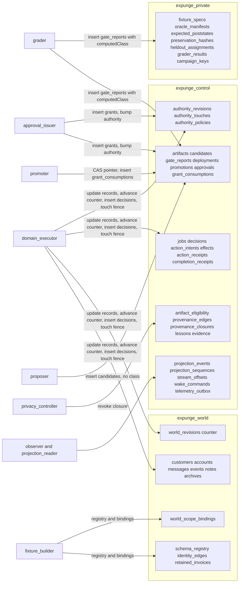

# MongoDB foundation (packages/mongo)

MongoDB is the authority for consequential domain and control state. This file says what the code touches, who may do
what, and how to run the protocol tests. **Every test result below comes from a local replica set. It proves protocol
behavior (transactions, fences, validators, unique indexes). It is not evidence about the invited Atlas deployment, Atlas
RBAC, or Search/Vector, and none of those has been exercised: there is no root `.env`, so all live Atlas checks are BLOCKED.**

## Principals (separate MongoClient and URI each; no fallback to setup)
| Principal | Does | Cannot (structurally) |
|---|---|---|
| setup | DDL, validators, indexes, seeds authority and policy, test administration | run in any model-accessible container |
| domain_executor | update domain records and the world counter, insert decisions, touch `authority_touches`, run cleanup jobs | write registry, bindings, `authority_revisions`, retained data, gate reports, grants |
| fixture_builder | create worlds, registry, bindings; private manifests | grants, authority, decisions |
| proposer | insert artifacts and candidate proposals | update anything, write a class, read private truth |
| grader | read private truth, insert gate reports (the only source of `computedClass`) | update a report, approvals, authority |
| approval_issuer | insert grants after checking them against the stored report; bump the authorization revision | edit or delete a grant, write reports |
| promoter | move deployment pointers, insert `grant_consumptions`, update candidate state | update `approvals`, `authority_revisions`, policy |
| privacy_controller / observer / projection_reader | revocation and retraction / evidence and outbox / read events | destructive domain tools, promotion |

Atlas privileges are additive and collection-level. `atlasRoleManifests()` is the body to apply through the Atlas
Administration API; driver `createRole` is used only by the local RBAC test.

## Protocol rules worth knowing
- **Approval is derived.** `promote` takes the class from the grader-written gate report and the requirement from the
  `authority_policies` row. `authority_expansion` always needs a grant, `tightening` never, `behavioral` per policy. The
  candidates row is a proposer's note and is never read for authorization. A grant must equal the binding derived from the
  stored report (hashes, flip-set digest, descriptor) at issue and at spend, and is spent by inserting a unique row.
- **Live authorization.** Effects, `complete`, `promote` and `rollback` read `authority_revisions` and conditionally write
  `authority_touches` under the expected revision; a bump rewrites both rows in one transaction, so a stale snapshot aborts.
  A stale run fails with `AuthorityRevisionStale`. An effect also needs a matching row in the `decisions` ledger
  (`decisionId`), and its `effectKey`, `argsDigest` and `targetHash` are derived by the repository, not supplied.
- **World = counter + binding.** The worker advances `world_revisions`; only setup and the fixture builder write
  `world_scope_bindings`, and rebinding also advances the counter so an in-flight effect conflicts.
  `JobRepository.create` requires an existing world under the actor's scope, at its scope revision, outside maintenance.
- **Scope paths.** Registered paths live under `data.*` (plus the read-only record key `_id`). `*` compiles to a filtered
  positional update or element `$pull`, never to a whole-array write.
- **Effects are bound to the versions the plan saw.** `commitEffect` requires `expectedDocumentVersions` to name exactly
  the intent's targets (once each, non-negative integer versions; otherwise `VersionBindingMismatch`), re-reads every
  target's `_rev` inside the transaction before `apply` runs (`StaleDocumentVersion`), and refuses an `apply` that returns
  fewer effects than targets (`PartialEffect`). A refused batch writes nothing: no effect row, receipt or counter move.
- **No world write outside an effect.** `ScopeRepository.writeField` takes the effect transaction's session and throws
  `EffectTransactionRequired` without one; `applyEffect` is the single-update path the gateway uses.
- **A world key comes from a stored row.** `JobRepository.worldKey(actor, jobId)` reads the job and mints the `WorldKey`;
  `WorldRepository.bind` mints one from the stored world binding. `worldKeyOf` is package-internal and not exported from the
  index, so no caller can brand a job-shaped object of its own.
- **Receipt refusals have their own codes.** A wrong verdict is `IncompleteReceipt` (complete) or `ReceiptNotIncomplete`
  (incomplete); a receipt that does not cover the registry is `ReceiptCoverageIncomplete`.
- **Decision rows come back as stored.** Recording the same decision again returns the stored row (with its first inputs and
  digest), never the caller's object. The ledger is insert-only by privilege; it is not hash-chained (see the G6 note in the
  review) and makes no tamper-evidence claim.
- **Approval-gated workflows cannot proceed yet.** The gateway resolves the `approval_grant` binding to "absent", so a
  bundle prerequisite on it always denies (fails closed) until grants are wired to the decision path.
- **Incomplete receipts.** `EffectRepository.complete` commits only a `complete_in_registered_scope` receipt with zero
  residuals and finishes the job `succeeded`. `completeIncomplete` commits an `incomplete` receipt (at least one residual)
  under the same job binding, registry coverage, authority fence and world checks, and finishes the job `failed` with that
  receipt as its output, so a run that claims success without having cleaned the data leaves a truthful committed record.
  Neither method accepts the other's verdict.
- **Campaign keys.** `expunge_private.campaign_keys` holds one 32-byte key per campaign for the fixture builder and grader
  (strict validator, insert-only; fixture builder inserts, fixture builder and grader read, nobody updates or removes).
- **Provenance.** Revocation is a bounded, resumable closure persisted in `provenance_closures`. `permitted` re-derives
  ancestry on every read and denies anything under an unresolved closure.
- **Projection events.** Sequences are per job and contiguous from 1: the counter increment and the event insert share one
  transaction, so an aborted transaction gives its number back. Payloads are validated against strict per-kind schemas.

## Residuals that collection-level RBAC cannot close (application-enforced, with the test that covers each)
Atlas privileges are per collection and per verb, never per field or value. Three grants are therefore broader than the rule
they serve, and the rule lives in code:
| Grant | Application rule | Test |
|---|---|---|
| `domain_executor` UPDATE on `world_revisions` | The counter only moves by a conditional `findOneAndUpdate` at the revision the intent was planned at; scope revision and maintenance live in `world_scope_bindings`, which the executor cannot write. A hand-written counter edit cannot widen scope. | `authority.integration.test.ts` (world split, rebinding conflicts with an in-flight effect); `rbac.integration.test.ts` (executor denied on the binding row) |
| `proposer` INSERT on `candidates` | A candidate row is a note: `promote` never reads it for authorization. The validator rejects a `computedClass`; a forged `state` is inert. | `hardening.integration.test.ts` (L11), `promotion.integration.test.ts` ("does not read the candidate row at all") |
| six principals UPDATE on `jobs` (executor, observer, grader, promoter, privacy_controller, fixture_builder) | `JOB_KIND_PRINCIPALS` limits claim/renew/checkpoint/yield/finish to the worker principal of the kind; every lease write is conditional on owner, fence and a live lease; a cleanup job reaches `succeeded` only with a committed, job-bound completion receipt; cancellation is terminal. The database adds the strict BSON schema and a query validator rejecting `succeeded` with empty `outputRefs`. A raw writer that sets `succeeded` plus fabricated `outputRefs` is not stopped by the database. | `hardening.integration.test.ts` (L1, L3), `rbac.integration.test.ts` ("job status" asserts both the guard and the known limitation) |

World access never takes a world id from a caller: `ScopeRepository` methods require a `WorldKey`, which only
`worldKeyOf(job)` (the stored run binding) or `WorldRepository.bind` (the stored world row under a trusted scope) can issue.

## Test lanes
| Lane | Needs | Command |
|---|---|---|
| Fast | nothing | `npx vitest run packages/contracts packages/mongo` (live suites skip with a reason) |
| Replica-set protocol | `MONGODB_TEST_URI` | `docker compose -f packages/mongo/test/docker-compose.yml up -d`, then `MONGODB_TEST_URI='mongodb://127.0.0.1:27018/?replicaSet=expunge-local&directConnection=true' npx vitest run packages/mongo` |
| Local authenticated RBAC | `MONGODB_RBAC_TEST_URI` | `docker compose -f packages/mongo/test/auth-docker-compose.yml up -d`, then set `MONGODB_RBAC_TEST_URI` for 127.0.0.1:27019 (replica set `expunge-auth`, authSource `admin`) |

Set `EXPUNGE_REQUIRE_LIVE_TESTS=1` for acceptance runs: a missing URI then fails the suite instead of skipping it. The RBAC
lane runs raw-driver probes for every principal, collection and verb against `atlasRoleManifests()`, plus explicit named
denials. The auth compose file carries a published, localhost-only placeholder credential (tmpfs, bound to 127.0.0.1); never
use it for a deployed database. One command for the whole local run once both containers are up is the Fast command with
both URIs and the require flag set.

## Setup
`npm run setup:mongo` installs collections, validators and indexes idempotently. With `EXPUNGE_AUTHORITY_FLOOR_HASH`
(64 hex) plus `EXPUNGE_TENANT_ID`, `EXPUNGE_ENV`, `EXPUNGE_SCOPE_ID` it also seeds that scope's authority row and a policy
per target; behavioral changes need approval unless `EXPUNGE_BEHAVIORAL_REQUIRES_APPROVAL` is exactly `0`. Without the
floor hash nothing is seeded and promotion and effects fail closed. `npm run probe:mongo` reports server version, topology
and transaction support without printing credentials.
