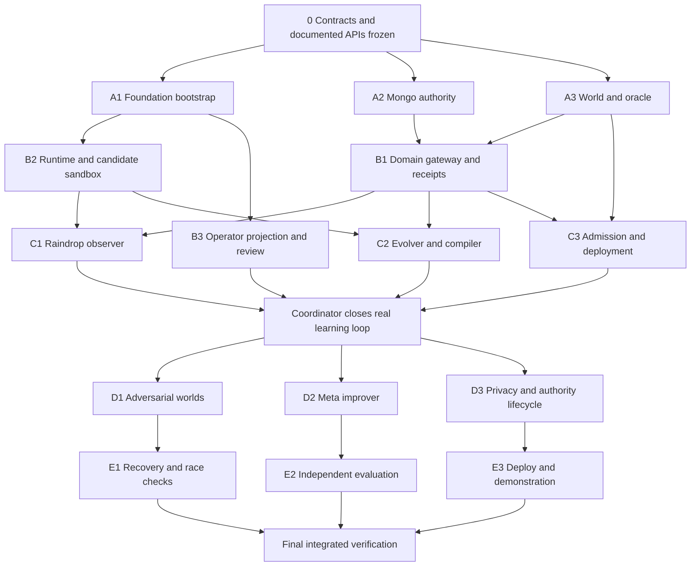

# Parallel Codex Implementation Tasks for Expunge

These are execution packets for the full blueprint. The coordinator has dispatched Wave A in parallel: application foundation, shared contracts/Mongo authority, and synthetic worlds/independent grader. Use the build reports and acceptance evidence for current completion status. The present environment has four agent slots including the coordinator; execute the dependency waves below, reusing agents between waves.

## Shared dispatch instructions

Paste this preamble with every task:

> Read EXPUNGE-IMPLEMENTATION-BLUEPRINT.md, docs/expunge/CONTRACTS.md, DATA-MODEL.md, ACCEPTANCE.md and SOURCE-MAP.md before editing. Read the exact cited upstream source and examples for your task; the local skill may contain older API examples. Implement only your owned files and the frozen interfaces. Report a proposed contract change to the coordinator before applying it. Keep full requested functionality. Do not invent vendor methods, update dependencies independently, expose the hidden grading manifest, or bypass the trusted gate. Preserve license notices for copied code. Distinguish mocks from real services in verification. Return changed files, source patterns used, documented signatures, commands/checks and actual results, unresolved issues and the integration handoff. Do not claim an unrun test passed.

The coordinator coordinates root package configuration, shared contracts, environment examples, integration glue and the final benchmark/report; Wave A delegates the root configuration and contracts implementation to A2 under that ownership. One agent at a time owns each upstream shell file. Credentials never go in prompts, fixtures, source patches or test output. Keep services/roles separated as specified. The user has authorized the full parallel build; each agent edits only its dispatched files.

## Dependency map

Some tasks can begin with frozen types before their dependencies have working implementations. A task cannot declare integrated acceptance until those implementations are connected. Starting parallel does not permit substituting a private mock protocol.

## Phase 0 Coordinator freeze

**Coordinator responsibilities:** choose the OpenDots snapshot and its package versions; record OpenBot bundled revision separately; write code contracts from CONTRACTS.md; install the supported BSON validators by hand; define fixture/evaluator commitments, module ownership and service identity binding. Create an initial typed worker bundle and expert-static bundle. Register terminal status/receipt semantics. Submit principally under Statement One and preserve the complete scope. The kickoff manifest must record the mandatory email-invitation Atlas Hackathon Sandbox identity and deployed connection, plus the recommended MongoDB Agent Skills → separate development MCP identity → schema/query guide sequence. Attribute pinned foundations and inventory new event work; legal licensing does not independently certify eligibility, and the guide does not mandate approval for every fork.

**Discovery references:** docs/research/blueprint-foundations.md, blueprint-mongodb.md and blueprint-raindrop.md. The source map is the allowed API list. Copy only the pinned source pattern appropriate to the app's versions.

**Verification:** source pins and licenses recorded; model profile/evaluator hashes defined; all task agents consume the same contract version; two integration fixtures are shared but held-out manifests remain private. No model run starts with broad database credentials.

## Wave A Foundations

### A1 OpenDots application and service bootstrap

**Own:** `apps/operator/` initial imported shell, THIRD_PARTY notices for that shell and `infra/opendots/`. Coordinator retains root workspace/dependency edits and secrets. Hand off operator files to B3 after boot; stop editing them then.

**Task:** use the inspected OpenDots Node 24/npm startup pattern. Preserve its auth, runtime, workspace and review UI. Establish a callable domain-service boundary and a simple committed-job projection endpoint. Start the existing supervisor/computer composition using its documented environment and pinned bundled OpenBot revision. Implement the new candidate-only container/network overlay: default-deny egress/proxy, internal control/artifact paths, bounded resources and no privileged credentials. The upstream setup does not supply restrictive egress. Provide a distinct template for hosted Intelligence versus local evaluation; never assume the license/key exists. Keep all Expunge authority outside incidental SQLite.

**Read/copy:** OpenDots docs/SETUP.md; docs/COMPUTERS.md; deployment/computers/README.md; src/server/platform.ts and computer-service.ts. Follow original lockfile versions before workspace integration.

**Prove:** the shell receives a real response with the chosen provider; owner auth/origin rules work; two Dots have separate computer credentials/workspaces; a computer action uses actor `agent`; the app has no Docker socket. An isolated sandbox performs a harmless candidate-file edit. A setup-only screen is reported as setup-only.

**Guards:** no fabricated `ask_dot`; sidecars do not import `govern()`; Node deployment does not imply Docker hosting; no master supervisor credential in a Dot workspace.

### A2 Atlas authority and repository primitives

**Own:** `packages/mongo/`, `scripts/setup-mongo.ts`, role/index/validator manifests and Mongo integration checks. Shared types remain coordinator-owned.

**Task:** implement the three-database layout; supported strict/error schemas; indexed repository primitives; insert-only artifacts; typed deployment CAS; job claims, renewal and fencing; approved grant consumption; unique logical effect keys; outbox/event logs; collection-level change-stream consumer. Build explicit factory methods for each service principal. Use the same client session inside one transaction and keep network calls outside callbacks.

**Read/copy:** official Node transaction examples, collection findOneAndUpdate/update pipeline signatures, Atlas custom roles, schema validation, change streams and aggregation constraints in the Mongo research report.

**Prove:** schema-invalid bundle refused; proposer cannot update/delete admitted artifacts or read private truth; exactly one of two same-parent promotions commits; a stale lease cannot write after takeover; transaction abort leaves no partial effect/grant consumption/pointer change; resume-token recovery works. Report actual Atlas privileges and cluster tier.

**Guards:** reading a fence is not acquiring a write fence; a session cannot span separate MongoClients; bypass validation privileges negate the boundary; partial unique index means at most one, not existence; TTL is not a lease expiry mechanism.

### A3 Synthetic worlds and independent evaluator

**Own:** `packages/fixtures/`, `packages/grader/`, sealed fixture tooling and private data seeding. The worker image must not contain manifests/held-out seed secrets.

**Task:** implement direct/nested/array/two-hop/cycle/alias reference layouts, unrelated namesakes, eligibility effects and partial-write/retry faults. The fixed generator independently creates expected poststates and preservation hashes. Write a reference solver and quarantine inadmissible worlds. Define two training structural families, protected twins and withheld compositions. Commit generator, solver, split and seed hashes before evolution.

**Read/copy:** CONTRACTS.md WorldSpec/TrialPair; DATA-MODEL.md private boundary; fresh literature's structural holdout and reference-admission protocols.

**Prove:** every admitted fixture is solvable; duplicate/namesake controls cannot be erased; blanket delete and blanket refuse both fail; operational verifier can say complete-in-known-scope while hidden grader detects a missing path; held-out data never appears in worker tools/logs/telemetry.

**Guards:** no model judge for primary correctness; no manifest-derived identity_edges; new customer IDs alone are not structural holdouts; reference solution and worker should not share the same incomplete discovery algorithm.

## Wave B Execution and experience

### B1 Domain gateway and completion receipts

**Own:** `packages/domain/`, `packages/governance/execute/` and domain-effect/operational-receipt checks. Do not edit promotion code.

**Task:** implement schema inspection, scoped identity/reference search, preview plan, owner eligibility rules, bounded delete/redact/restrict/tombstone batches, exactly keyed effect receipts and registered-scope verification. Follow OpenBot's authoritative-resolution/policy/decision/action/outcome ordering, with a new async Mongo receipt/history gate. Compile field IDs and bindings through approved factories. Every destructive effect touches the job fence and WorldRevision transactionally. Implement live authority revocation even on pinned runs.

**Read/copy:** OpenBot gateway/policy source and their actual boundaries; DATA-MODEL.md execution protocol; official transaction/fencing examples.

**Prove:** stale target versions/receipts, wrong actor/world and duplicate logical actions are handled correctly; partial batches resume without repeated effects; operational receipt is based only on visible registered/discovered data; completion rejects a changed world/scope revision; actions declared retained by fixed owner policy remain retained.

**Guards:** no raw destructive Mongo tools exposed to the model; no arbitrary query JSON or `$where`/`$function`; hidden oracle does not mint operational receipts; log intent before action but never call a vendor inside a retrying transaction.

### B2 OpenMuse runtime helpers and OpenBot candidate sandbox

**Own:** `apps/worker/` durable dispatcher/worker entrypoints, `packages/runtime/`, `packages/vendor-openmuse/`, worker runtime adapter and sandbox artifact transport. Operator projection-agent registration glue remains B3/coordinator-owned.

**Task:** port the specific OpenMuse `tanstackAgent` provider/state/step-limit helpers with license and source pin into the app's pinned TanStack/CopilotKit versions. Build ExpungeExecutionAgent in apps/worker around the documented per-run construction seam. Resolve bundle/actor from a stored job, claim/renew it through A2 primitives and consume authenticated wake commands idempotently. Use a custom outer AbstractAgent that preserves dependencies on clone and constructs the wrapped BuiltInAgent inside `run`. Persist events through the projection/tracing adapter independently of the operator turn. Bound each model/tool phase and checkpoint between them. OpenBot candidate workspaces may edit candidate files and run local checks; the trusted service imports validated artifacts and performs independent evaluation outside that workspace. Verify A1's restrictive-egress overlay while preserving the admitted artifact/broker transport.

**Read/copy:** OpenMuse engine/tanstack-agent.ts, model.ts and conversation.ts; OpenDots DotAgent clone/run/factory; pinned AG-UI 0.0.59 AbstractAgent; pinned CopilotKit 1.75 converter/source; ComputerService.action and computer-tools inputs.

**Prove:** one @ag-ui/client version; runtime clone preserves role/job binding and wrappers; state snapshot/delta and text/tool boundaries behave under the actual converter; cancellation propagates; provider adapters return the expected AsyncIterable chunks; a candidate workspace cannot read private fixtures/credentials or promote itself.

**Guards:** `AbstractAgent` comes from @ag-ui/client; run returns Observable, while the TanStack factory returns AsyncIterable chunks; monkey-patching an inner BuiltInAgent is not preserved by every runtime clone; an old converter workaround must be checked before copying it; no client state grants authority.

### B3 OpenDots workbench and human review

**Own:** `apps/operator/src/client/expunge/`, `apps/operator/src/server/expunge/`, selected shell registration files after A1 handoff. Coordinate any changes to platform.ts/dot-agent.ts with the parent.

**Task:** show real domain jobs, a record/reference view, tool decisions, Raindrop evidence links, harness diff, paired tests, lineage, approvals and completion receipts. Register ExpungeProjectionAgent, which submits/observes jobs and emits finite acknowledgment/review turns instead of running model campaigns. Register a typed new review tool through both the frontend HITL hook and the backend frontend-tool allowlist. Use the authenticated events route for continuing committed projection; reconnect with snapshot+event sequence. For receipt-mode runs, suppress raw worker terminal text/state authority and render the committed completion response. Keep model narrative visibly distinct in the baseline mode. A UI turn ending never marks the durable job complete.

**Read/copy:** OpenDots Chat.tsx ConnectionActionCard/HITL pattern, connection-routes.ts stored arguments, DotAgent frontendTools filter and config watcher; verified AG-UI state event contracts.

**Prove:** approval UI sends an ID/decision only; changed args or stale grant rejected server-side; page reload resumes current job without restarting it; model state cannot make a candidate active; completion banner/hash/counts match Atlas receipts; denied candidate shown with actual reason.

**Guards:** a hook alone does not expose a new frontend tool; SQL approval does not authorize Atlas promotion; provider skill/memory injection cannot remain an uncontrolled second context path; never show a mock as delivered.

## Wave C Close the learning loop

### C1 Raindrop worker improver and observer integration

**Own:** `packages/observability/`, `packages/observer/` and telemetry adapters/read-back checks. Internal HTTP authentication glue remains coordinator-owned.

**Task:** instrument worker and improver using the documented interaction/tool/subagent APIs, with opaque demo subject identities and source labels. Implement transactional outbox enqueue/flush/read-back states. Query actual events/traces with documented filters, bounded pagination and enrichment retries. Deduplicate events and incident jobs before cursor advancement. Supply sanitized EvidenceBundles to the proposer and write accepted/rejected outcomes back. Add hosted Issues/Experiments via actual account-discovered MCP schemas. Keep failure origins explicit.

**Read/copy:** docs/research/blueprint-raindrop.md and its exact SDK declarations/OpenAPI; original SDK examples; real Self Diagnostics execute pattern.

**Prove:** same run/harness hashes in Atlas and remote event; finish/close awaited; enqueue alone cannot mark evidence ready; diagnostics dispatch reaches execute; a late-enriched event is reconsidered; score-only and wrong-incident controls have the same budget; improver events are independently inspectable.

**Guards:** /v1/signals is a catalog; trackSignal buffering does not prove delivery; no invented links[] or REST Issues route; unsupported exact MCP inputs require tools/list discovery; Raindrop outage does not become “no failures.”

### C2 Evolver typed mutation compiler and replay

**Own:** `packages/evolution/`, `packages/harness-compiler/` and proposal/replay checks. Do not mutate evaluator or authority schemas.

**Task:** diagnose from raw permitted EvidenceBundles, propose composable changes across context/workflow/guardrail/tool policy, cite source incidents and compile a bounded typed AST. Compute mutation class independently. Run recorded-decision replay with as-of facts and known authority flips; preserve runtime/replay operator semantics. Require standing for each edit: cited deficiency and observed effect. Reject task/subject literal shortcuts. Freeze initial/expert policies and disclose human-authored primitives.

**Read/copy:** CONTRACTS.md HarnessBundle/Candidate; source verified Mongo expressions; Self-Healing Harness/RRSI/Phantom Guardrails evidence in the literature audit. OpenBot dryRunAgainstHistory supplies a decision-replay pattern, not behavioral proof.

**Prove:** unknown nodes, malformed graphs, unbounded loops and authority expansions are classified/rejected; each patch carries evidence and parent/hash; a known regression appears in replay; live evaluator uses the same admitted operator semantics; new schema composition transfer can be tested without subject literals.

**Guards:** model-reported scores/classes are not admission; replaying old actions cannot establish new agent behavior; `govern()` is not an exported vendor function; a bundle containing free personal-data instructions defeats the structural lesson policy.

### C3 Fresh evaluation admission promotion and rollback

**Own:** `packages/gate/`, `packages/deployment/`, campaigns and admission/race checks.

**Task:** run parent/candidate on reset paired worlds under frozen profiles and equal budgets. Join hidden-grade outputs only through the grader interface. Require trigger improvement, protected-case nonregression, held-out transfer, cost bounds and immutable artifact evidence. Produce GateReport. Implement approval classification/descriptor binding and transactionally consume a grant, CAS the exact tested parent, and insert promotion. Rollback creates a new pointer transition; in-flight runs stay pinned.

**Read/copy:** A2 repository primitives, fixed trial contracts, official Node transaction/CAS patterns, OpenDots stored-argument approval pattern and its missing version/consumption fields.

**Prove:** blanket refuse/delete fail admission; failed/cancelled trials do not disappear; two same-parent candidates cannot both commit; expired/changed/consumed approval fails; pointer/report digest mismatch fails; rollback is auditable; full end-to-end loop changes a new run's actual behavior.

**Guards:** no model/API call inside promotion transaction; no operational cleanup effects in promotion; no “best” candidate selected on held-out results and then labeled untouched evaluation; no metrics extracted from a model's success prose.

## Coordinator integration checkpoint

Connect B1–B3 and C1–C3 before adding further campaign traffic. The checkpoint is a real baseline failure, remotely read-back evidence, a generated patch, paired fresh tests, a committed promotion and a new pinned run. Include an unsafe patch with an actual rejection. This checkpoint sequences the full build; it does not remove the later scope.

## Wave D Full scope loops and privacy

### D1 Hider and adversarial curriculum

**Own:** `packages/adversary/` and adversary campaign tools.

**Task:** generate harder WorldSpecs within frozen admission/resource rules; ask the trusted generator/reference solver to admit them. Keep structural novelty families and private targets separated. Use current admitted worker failures as reward and retain valid counterexamples as training precedents. Evaluate novel compositions separately from changing customer names.

**Prove:** impossible worlds quarantined; Hider cannot alter manifests/scorer; same-seed replay is deterministic; at least one admitted new structural world reveals a measured worker limitation; protected cases remain in future gates.

**Guards:** do not move the goalposts or leak held-out specs to the worker; curriculum growth alone is not improved meta-learning.

### D2 Improver evolution and fresh-base comparison

**Own:** `packages/meta-evolution/`, meta-campaign definitions and raw result export.

**Task:** version an improver harness with editable evidence selection, diagnosis workflow, critic/pruning strategy and bounded proposal budget. Observe it in Raindrop. Propose I1 using permitted previous improvement traces; gate it by the workers it produces from identical reset W0 instances on new incidents. Use equal budgets, further withheld worker tests, I0/I0 noise control and a no-data rewrite control. Store all trial outcomes and compute amortized costs.

**Prove:** I0/I1 cannot read evaluator truth; fresh workers have no inherited memory/artifacts; comparison pins identical base/model/budgets; raw per-pair outcomes and null results are retained; a claimed recursion premium is backed by produced-worker improvement.

**Guards:** no scoring the improver's explanation; no inherited worker improvements masquerading as better optimizer; no claim of model-weight improvement or indefinite acceleration.

### D3 Provenance erasure approvals and context eligibility

**Own:** `packages/privacy/`, source eligibility/erasure protocol and privacy integration checks.

**Task:** register raw evidence, structural lessons and their derivation graph. Retract a source, invalidate future retrieval, redact/delete permitted personal material, revoke/regenerate affected artifacts when necessary and preserve permitted nonpersonal tombstones. Bind approval to trusted rendered scope/flip-set and consume it exactly once through gate primitives. Implement Raindrop deletion request/status polling using exact schema and explicit org-wide scope. Register Intelligence conversation retention as a separate provider boundary.

**Prove:** subject literal scan/policy checks on retained artifacts; revoked sources cannot be retrieved by new runs; actual active artifact containing forbidden material is revoked; domain completion can coexist with accurately pending external erasure; provider acknowledgment is not purge confirmation; cancel-user DELETE is never used as an erasure command.

**Guards:** immutable archive is not a privacy exemption; log deletion may remove learning evidence, so gate provenance policy before retaining its lesson; do not promise instant vendor deletion or unverified Intelligence purge.

## Wave E Evidence reliability and delivery

### E1 Failure recovery race and containment review

**Own:** `tests/reliability/`, fault-injection drivers and reliability findings. Coordinate code fixes with original owners.

**Task:** kill/restart workers at pre-effect/post-commit/pre-projection points; force lease expiry/takeover; interrupt batch writes and remote telemetry; expire resume token; race approvals and promotions; revoke scope mid-run; attempt cross-world query and oracle access; verify candidate sandbox isolation.

**Prove:** bounded effects, no stale-owner commit, durable checkpoint replay, no duplicate logical effects, recoverable projection and honest waiting states. Record all actual checks and limitations.

### E2 Independent benchmark and scientific review

**Own:** `tests/evaluation/`, preregistration, benchmark exports and report generation.

**Task:** run initial, expert-static, evolved, score-only and wrong-incident conditions on frozen structural holdouts. Include repeated stochastic runs, raw pair data, cost and failures. Independently inspect manifest isolation and reference solver independence. Run meta comparisons and document uncertainty. Do not tune after inspecting the final held-out test.

**Prove:** hashes match displayed table; model/provider/budget/data splits pinned; causal controls genuine; negative/no-gain trials retained; no made-up percentages or tiny-sample certainty. If expert-static ties evolved, report the tie.

### E3 Deployment operator rehearsal and submission

**Own:** `infra/deploy/`, deployment runbook, demo reset/prefill drivers and submission documentation.

**Task:** deploy the operator and domain workers with their actual host requirements; keep Docker sidecars on an appropriate host. Configure HTTPS, auth, origin rules, server-only secrets and health endpoints. Use the email-invitation Atlas Hackathon Sandbox. Build idempotent demo world reset, preserve benchmark data, rehearse three minutes and record on site on October 11. Prepare the Cerebral Valley submission with public repository, accessible demo, one-minute video and description of newly built event functionality; record attendee/finalist presence and human team size at most four. Keep pinned-foundation attribution and original-work inventory.

**Prove:** anonymous public repository and accessible-demo checks; deployed services use the same pinned artifacts and mandatory sandbox as the report; a real run closes the loop; honest replay switch available; Cerebral Valley links and one-minute audio/video playback work; on-site October 11 recording and attendance/finalist-presence checklist is complete. Deployment performs no invented service/account setup, and eligibility is not independently certified by the build agent.

## Final coordinator review

Read every agent's source/check report. Reconcile root dependency versions and interfaces. Verify all ACCEPTANCE.md invariants, source-map APIs, private-image contents, full-scope feature matrix and deployed behavior. Fix issues through the owning agent. Close work-state items only when the claimed phase artifacts and evidence exist. Do not call the application implemented merely because this blueprint is complete.
